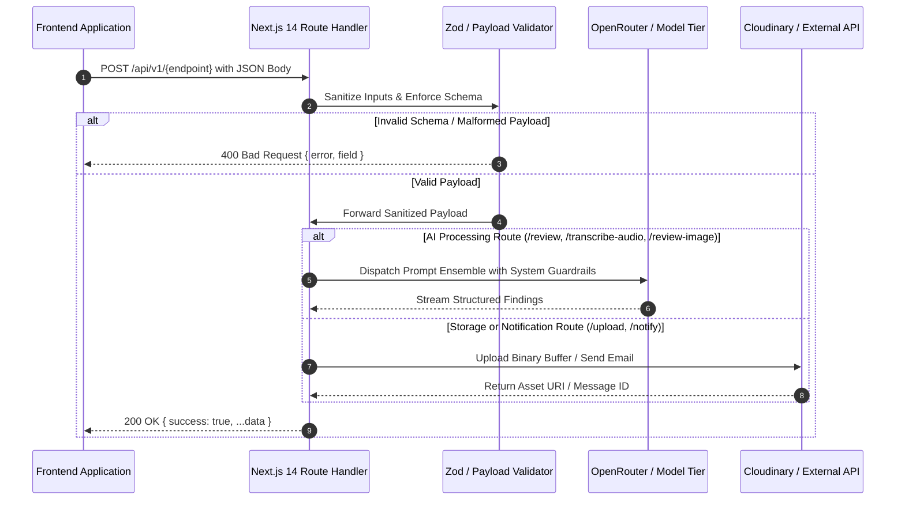

# REST API Reference & Serverless Route Handlers — VibeCheck AI

```
+========================================================================================+
|                             API ARCHITECTURE SPECIFICATION                             |
+========================================================================================+
| Protocol: HTTPS / REST / JSON (RFC-8259)        | Runtime: Next.js 14 App Router Edge  |
| Base URL: https://vibecheck-ai.vercel.app/api   | Authentication: Bearer Token / Key   |
| Status Codes: 200, 400, 401, 404, 422, 500      | Content-Type: application/json       |
+========================================================================================+
```

---

## 1. Route Catalog & Service Matrix

| Method | Endpoint | Primary Purpose | Auth Required | Runtime Target |
| :--- | :--- | :--- | :--- | :--- |
| `POST` | `/api/review` | Multi-agent text compliance audit & rewriting | Optional User Key | Node.js / Edge |
| `POST` | `/api/transcribe-audio` | Real-time audio speech-to-text transcription | None (Public) | Node.js / Edge |
| `POST` | `/api/review-image` | Computer vision color harmony & WCAG audit | Optional User Key | Node.js Serverless |
| `POST` | `/api/extract-docx` | Binary Word document text/structure extraction | None | Node.js Buffer |
| `POST` | `/api/notify` | Transactional email dispatch via Resend | Server Secret | Node.js Serverless |
| `POST` | `/api/upload` | Secure media storage via Cloudinary CDN | Session Auth | Node.js Serverless |

---

## 2. API Request-Response Lifecycle Flow



---

## 3. Detailed Endpoint Specifications

### 3.1 Content Audit Review (`POST /api/review`)

Evaluates editorial text against multi-axis tone sliders, clinical/financial claims, and competitor blacklists.

```
+---------------------------------------------------------------------------------------+
| POST /api/review                                                                      |
+---------------------------------------------------------------------------------------+
| Headers: Content-Type: application/json | Authorization: Bearer <API_KEY> (optional)   |
+---------------------------------------------------------------------------------------+
```

#### Request Payload Schema
```json
{
  "content": "Our metabolic protocol cures diabetes within 48 hours. Unlike OmniCare, we are cheap.",
  "guidelines": {
    "brandName": "Lumina Health",
    "toneParameters": {
      "formality": 80,
      "seriousness": 85,
      "boldness": 60
    },
    "approvedClaims": [
      {
        "id": "cl_01",
        "claim": "Demonstrated 34% reduction in acute symptom flares within 90 days.",
        "citation": "New England Journal of Medicine, Nov 2024"
      }
    ],
    "prohibitedTerms": ["miracle cure", "cheap", "100% guaranteed"],
    "competitorMentions": ["OmniCare Health", "OmniCare"]
  },
  "format": "ad_copy",
  "channel": "LinkedIn Executive",
  "apiKey": "sk-or-v1-optional-user-key"
}
```

#### Response Payload (`200 OK`)
```json
{
  "success": true,
  "result": {
    "overallScore": 54,
    "summary": "Severe regulatory breaches detected: unapproved clinical promise and rival trademark citation.",
    "issues": [
      {
        "id": "iss_101",
        "category": "claims",
        "severity": "critical",
        "guidelineRef": "RULE-CLAIM-EXCESS",
        "message": "The assertion 'cures diabetes within 48 hours' is not found in approved claim repository.",
        "flaggedText": "cures diabetes within 48 hours",
        "suggestion": "supports sustainable glycemic control",
        "status": "pending"
      },
      {
        "id": "iss_102",
        "category": "competitor",
        "severity": "major",
        "guidelineRef": "RULE-COMPETITOR-LOCKOUT",
        "message": "Competitor entity 'OmniCare' is explicitly barred from brand collaterals.",
        "flaggedText": "Unlike OmniCare",
        "suggestion": "Compared to conventional institutional alternatives",
        "status": "pending"
      }
    ],
    "rewrittenText": "Our metabolic protocol supports sustainable glycemic control backed by clinical research. Compared to conventional institutional alternatives, our solutions remain highly capital-efficient."
  }
}
```

---

### 3.2 Speech Audio Transcription (`POST /api/transcribe-audio`)

Direct audio speech-to-text pipeline that operates without forced authentication barriers for fluid editorial audits.

```
+---------------------------------------------------------------------------------------+
| POST /api/transcribe-audio                                                            |
+---------------------------------------------------------------------------------------+
| Headers: Content-Type: application/json                                               |
+---------------------------------------------------------------------------------------+
```

#### Request Payload Schema
```json
{
  "audioBase64": "UklGRiQAAABXQVZFZm10IBAAAAABAAEARKwAAIhYAQACABAAZGF0YQAAAAA...",
  "mimeType": "audio/mp3",
  "apiKey": "sk-or-v1-optional-key"
}
```

#### Response Payload (`200 OK`)
```json
{
  "success": true,
  "transcript": "Good morning team. During our Q3 clinical trial readout, patient compliance reached 94% with zero adverse events recorded over the twelve-week evaluation cycle."
}
```

---

### 3.3 Computer Vision Image Review (`POST /api/review-image`)

Evaluates visual assets against brand color palettes, watermark detection, and visual contrast ratios.

```
+---------------------------------------------------------------------------------------+
| POST /api/review-image                                                                |
+---------------------------------------------------------------------------------------+
| Headers: Content-Type: application/json                                               |
+---------------------------------------------------------------------------------------+
```

#### Request Payload Schema
```json
{
  "imageBase64": "data:image/png;base64,iVBORw0KGgoAAAANSUhEUgAA...",
  "guidelines": {
    "colorPalette": {
      "primary": "#3C311F",
      "secondary": "#9C8561",
      "accent": "#065F46"
    }
  }
}
```

#### Response Payload (`200 OK`)
```json
{
  "success": true,
  "result": {
    "paletteScore": 94,
    "contrastRatio": 7.8,
    "contrastAAA": true,
    "stockWatermarkDetected": false,
    "dominantColors": ["#3C311F", "#FBF8F3", "#9C8561"],
    "recommendations": [
      "Visual hierarchy complies with enterprise publication standards."
    ]
  }
}
```

---

### 3.4 Document Text Extraction (`POST /api/extract-docx`)

Extracts text, hierarchy, and tables from `.docx` binaries via server-side Mammoth.js buffer processing.

```
+---------------------------------------------------------------------------------------+
| POST /api/extract-docx                                                                |
+---------------------------------------------------------------------------------------+
| Headers: Content-Type: multipart/form-data                                            |
+---------------------------------------------------------------------------------------+
```

#### Form Data Fields
- `file`: Binary file stream (`.docx`)

#### Response Payload (`200 OK`)
```json
{
  "success": true,
  "text": "Lumina Health Annual Quality Report\n\n1. Clinical Governance\nOur review of patient adherence demonstrates...",
  "fileName": "Annual_Quality_Report.docx"
}
```

---

### 3.5 Asset Cloudinary Upload (`POST /api/upload`)

Secure storage route for editorial attachments, certified documents, and brand creative banners.

```
+---------------------------------------------------------------------------------------+
| POST /api/upload                                                                      |
+---------------------------------------------------------------------------------------+
| Headers: Content-Type: application/json                                               |
+---------------------------------------------------------------------------------------+
```

#### Request Payload Schema
```json
{
  "fileBase64": "data:image/jpeg;base64,/9j/4AAQSkZJRgABAQEASABIAAD...",
  "fileName": "executive_press_release_banner.jpg",
  "folder": "vibecheck_brand_assets"
}
```

#### Response Payload (`200 OK`)
```json
{
  "success": true,
  "asset": {
    "public_id": "vibecheck_brand_assets/x8912384729",
    "secure_url": "https://res.cloudinary.com/vibecheck/image/upload/v1700000000/x8912384729.jpg",
    "format": "jpg",
    "bytes": 245890
  }
}
```

---

### 3.6 Editorial Alerts Dispatch (`POST /api/notify`)

Sends transactional editorial notifications to reviewers, managers, and legal signatories via Resend.

```
+---------------------------------------------------------------------------------------+
| POST /api/notify                                                                      |
+---------------------------------------------------------------------------------------+
| Headers: Content-Type: application/json                                               |
+---------------------------------------------------------------------------------------+
```

#### Request Payload Schema
```json
{
  "to": "elena.rostova@luminahealth.org",
  "subject": "VibeCheck AI: Revision Requested on 'Metabolic Therapeutics Brief'",
  "html": "<p>Reviewer Julian Vance has requested revisions regarding quantitative claim citations.</p>"
}
```

#### Response Payload (`200 OK`)
```json
{
  "success": true,
  "id": "msg_01HX98Z190AB7281"
}
```

---

## 4. Global HTTP Error Handling Matrix

```
+---------------------------------------------------------------------------------------+
| ERROR CODE TAXONOMY & RESOLUTION GUIDE                                                |
+---------------------------------------------------------------------------------------+
| Status Code | Meaning             | Trigger Condition               | Mitigation      |
+-------------+---------------------+---------------------------------+-----------------+
| 400         | Bad Request         | Missing required JSON key       | Inspect payload |
| 401         | Unauthorized        | Invalid or missing API token    | Configure key   |
| 413         | Payload Too Large   | Audio/DOCX exceeds 15MB limit   | Compress input  |
| 422         | Unprocessable Entity| Invalid base64 encoding stream  | Verify encoding |
| 500         | Internal Error      | Upstream AI provider failure    | Auto-retry / log|
+---------------------------------------------------------------------------------------+
```

```json
{
  "success": false,
  "error": "Missing audio data in payload",
  "code": "ERR_INVALID_PAYLOAD",
  "timestamp": "2026-11-13T08:00:00.000Z"
}
```
