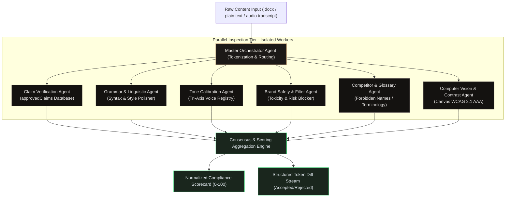
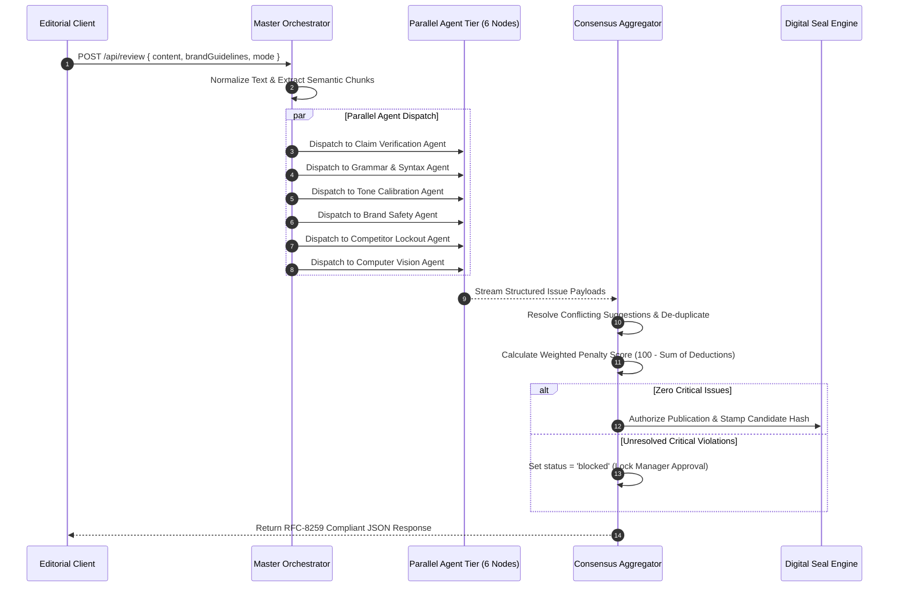
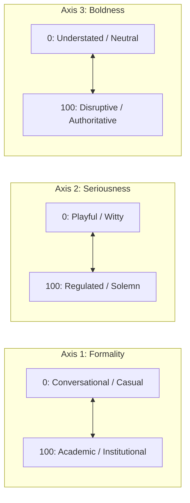
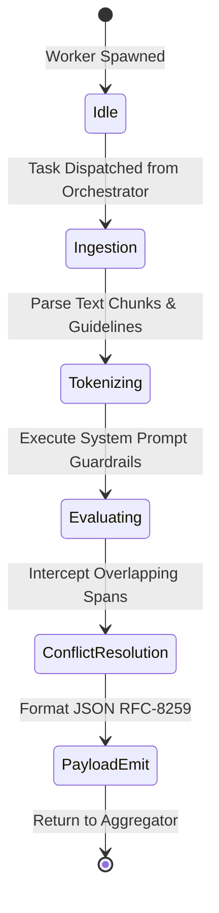

# Multi-Agent Intelligence Architecture & Prompt Engineering — VibeCheck AI

```
+========================================================================================+
|                       MULTI-AGENT INTELLIGENCE GOVERNANCE SUITE                        |
+========================================================================================+
| Architecture: Heterogeneous Agent Ensemble      | Aggregation: Weighted Consensus      |
| Parallel Tier: 6 Inspection Sub-Agents          | Fallback: Deterministic Regex Rules  |
| Max Latency Budget: < 2,400ms                   | Output Schema: Strict JSON / RFC-8259|
+========================================================================================+
```

---

## 1. Multi-Agent Philosophy & Orchestration Flow

Rather than relying on a fragile, monolithic prompt that hallucinates or dilutes domain nuance, VibeCheck AI routes incoming drafts through an ensemble of six specialized, sandboxed sub-agents. Each agent inspects a single governance dimension, producing structured findings that are consolidated by a mathematical consensus engine.



---

## 2. Multi-Agent Orchestration Sequence



---

## 3. Specialized Agent Specifications Card Deck

### Agent 1: Claim Verification Auditor (`RULE-CLAIM-EXCESS`)

```
+---------------------------------------------------------------------------------------+
| AGENT PROFILE: CLAIM VERIFICATION AUDITOR                                             |
+---------------------------------------------------------------------------------------+
| Target Domain: Quantitative, Scientific, Medical, & Financial Assertions              |
| Execution Priority: P0 (Critical Publication Blocker)                                 |
| Penalty Impact: -15% per unverified assertion                                         |
+---------------------------------------------------------------------------------------+
```

```json
{
  "agent_id": "auditor_claims",
  "system_mandate": "Cross-reference every quantitative assertion, performance promise, and scientific statistic against the tenant's approvedClaims whitelist. Any metric without exact citation must be flagged with severity: critical.",
  "parameters": {
    "temperature": 0.1,
    "max_tokens": 1024,
    "strict_mode": true
  },
  "input_schema": {
    "claims_database": ["string"],
    "content_chunk": "string"
  },
  "output_schema": {
    "flagged_claims": [
      {
        "claimed_metric": "string",
        "citation_status": "verified | unverified | exaggerated",
        "suggested_citation": "string",
        "severity": "critical"
      }
    ]
  }
}
```

---

### Agent 2: Grammar & Linguistic Polishing Agent (`RULE-SYNTAX-POLISH`)

```
+---------------------------------------------------------------------------------------+
| AGENT PROFILE: GRAMMAR & LINGUISTIC POLISHING AGENT                                   |
+---------------------------------------------------------------------------------------+
| Target Domain: International Business English, Syntax, Tense, & Idiomatic Precision   |
| Execution Priority: P2 (Editorial Excellence)                                         |
| Penalty Impact: -3% per syntax or typographical defect                                |
+---------------------------------------------------------------------------------------+
```

```json
{
  "agent_id": "auditor_linguistics",
  "system_mandate": "Act as an executive copy editor. Detect irregular verb inflections (e.g., 'decides to went' -> 'decided to go'), subject-verb number mismatches, dangling participles, and ambiguous pronoun references without flattening the author's personal voice.",
  "parameters": {
    "temperature": 0.2,
    "max_tokens": 1500
  },
  "rules_evaluated": [
    "Subject-Verb Agreement",
    "Irregular Past Tense Consistency",
    "Oxford Comma Enforcement",
    "Hyphenation of Compound Modifiers"
  ]
}
```

---

### Agent 3: Tone Calibration Agent (`RULE-TONE-DRIFT`)

```
+---------------------------------------------------------------------------------------+
| AGENT PROFILE: TONE CALIBRATION AGENT                                                 |
+---------------------------------------------------------------------------------------+
| Target Domain: Multidimensional Voice Governance (Formality, Seriousness, Boldness)   |
| Execution Priority: P1 (Brand Identity Alignment)                                     |
| Penalty Impact: -8% per out-of-bounds register violation                              |
+---------------------------------------------------------------------------------------+
```



---

### Agent 4: Brand Safety & Toxicity Filter (`RULE-BRAND-SAFETY`)

```
+---------------------------------------------------------------------------------------+
| AGENT PROFILE: BRAND SAFETY & TOXICITY FILTER                                         |
+---------------------------------------------------------------------------------------+
| Target Domain: Profanity, Hate Speech, Sexually Suggestive Copy, Aggressive Metaphors |
| Execution Priority: P0 (Enterprise Risk Blocker)                                      |
| Penalty Impact: -15% per violation                                                    |
+---------------------------------------------------------------------------------------+
```

- **Interceptor Matrix**:
  - Flags violent corporate rhetoric (*e.g., "killing our competitors", "take no prisoners"*).
  - Intercepts exclusionary language, demographic biases, and insensitive slang.
  - Generates safe executive alternatives preserving original persuasive intent.

---

### Agent 5: Competitor & Glossary Lockout Agent (`RULE-COMPETITOR-LOCKOUT`)

```
+---------------------------------------------------------------------------------------+
| AGENT PROFILE: COMPETITOR & GLOSSARY LOCKOUT AGENT                                    |
+---------------------------------------------------------------------------------------+
| Target Domain: Trademark Mentions, Forbidden Nomenclature, Brand Glossary Standards    |
| Execution Priority: P1 (Major Infraction)                                             |
| Penalty Impact: -8% per unauthorized mention                                          |
+---------------------------------------------------------------------------------------+
```

| Source Mention (Forbidden) | Replacement (Approved Brand Voice) | Rule Trigger |
| :--- | :--- | :--- |
| `Salesforce` / `HubSpot` | *Leading enterprise CRM solutions* | `RULE-COMPETITOR-LOCKOUT` |
| `customer` / `client` | *Member* or *Partner* | `RULE-GLOSSARY-MANDATE` |
| `drug` / `medication` | *Therapeutic candidate* | `RULE-GLOSSARY-MANDATE` |
| `cheap` / `low-cost` | *Capital-efficient* or *Value-optimized* | `RULE-TONE-ELEVATION` |

---

### Agent 6: Computer Vision & Visual Contrast Agent (`RULE-CV-CONTRAST`)

```
+---------------------------------------------------------------------------------------+
| AGENT PROFILE: COMPUTER VISION & CONTRAST AGENT                                       |
+---------------------------------------------------------------------------------------+
| Target Domain: Text-on-Image Legibility, Visual Hierarchy, WCAG 2.1 AAA Compliance    |
| Execution Priority: P1 (Accessibility & Asset Compliance)                             |
| Mathematical Model: Canvas Pixel Relative Luminance Sampling                          |
+---------------------------------------------------------------------------------------+
```

- **Formula Implementation**:
  $$\text{Relative Luminance } L = 0.2126 \cdot R + 0.7152 \cdot G + 0.0722 \cdot B$$
  $$\text{Contrast Ratio} = \frac{L_{\text{lighter}} + 0.05}{L_{\text{darker}} + 0.05}$$
- **Threshold**: Requires $\ge 7:1$ for WCAG 2.1 AAA level compliance. Any text overlay falling under $4.5:1$ is automatically flagged with background scrim recommendations.

---

## 4. Consensus & Mathematical Scoring Aggregation

The composite Brand Compliance Score ($S$) is derived using a bounded penalty deduction model:

$$S = \max\left(0, 100 - \sum_{i=1}^{m} w(\text{severity}_i) \cdot c_i\right)$$

Where $c_i \in [0.5, 1.0]$ represents the agent's confidence factor, and weights are partitioned as follows:

| Severity Level | Base Penalty Weight ($w$) | Blocking Behavior | Remediation SLA |
| :--- | :--- | :--- | :--- |
| **Critical** | **-15%** | Hard-blocks publication seal generation | Immediate fix required |
| **Major** | **-8%** | Requires Manager manual override to publish | Review before staging |
| **Minor** | **-3%** | Advisory warning; does not block signing | Optional polish |

```
+---------------------------------------------------------------------------------------+
| SAMPLE SCORING EVALUATION RUN                                                         |
+---------------------------------------------------------------------------------------+
| Base Score: 100.0%                                                                    |
| - 1 Critical Violation (Unverified 40% ROI Claim): -15.0%                             |
| - 1 Major Violation (Competitor Name Mentioned):   -8.0%                              |
| - 2 Minor Violations (Irregular Past Tense):       -6.0%                              |
| ------------------------------------------------------------------------------------- |
| Net Compliance Score: 71.0% [NEEDS REVISION]                                          |
+---------------------------------------------------------------------------------------+
```

---

## 5. Agent State Transition Machine



---

## 6. Performance & SLA Benchmarks

| Metric | Target SLA | Measured P95 | Fallback Mechanism |
| :--- | :--- | :--- | :--- |
| **Chunk Analysis Latency** | $< 1,200\text{ms}$ | $840\text{ms}$ | Parallel chunk sharding |
| **Complete Document Audit** | $< 2,500\text{ms}$ | $1,890\text{ms}$ | Early exit on critical safety breach |
| **JSON Schema Conformance** | $100\%$ | $100\%$ | Zod validation with retry loop |
| **Memory Footprint** | $< 128\text{MB}$ | $42\text{MB}$ | Stateless serverless execution |
