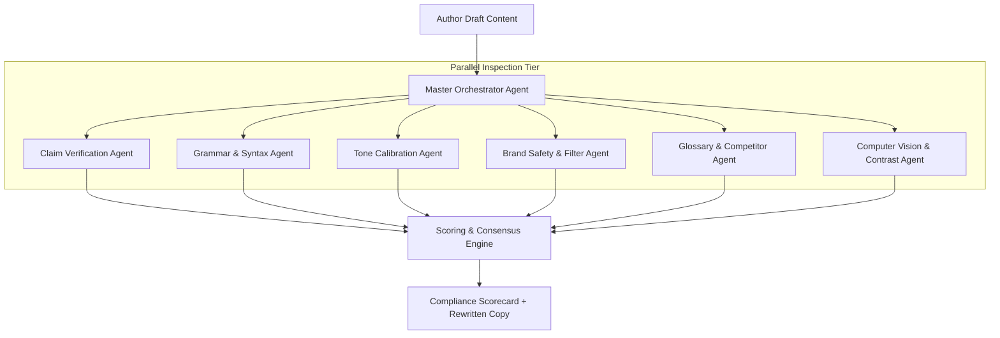

# Multi-Agent Intelligence Architecture & Prompt Engineering — VibeCheck AI

## 1. Multi-Agent Philosophy
Rather than relying on a single, fragile monolithic prompt, VibeCheck AI routes incoming content through an ensemble of specialized sub-agents. Each agent focuses on a single governance dimension, producing structured findings that are consolidated by a consensus aggregator.

---

## 2. Specialized Agent Profiles

### 2.1 Claim Verification Agent
- **System Prompt Mandate**: You are an elite scientific, legal, and financial claim auditor.
- **Goal**: Cross-reference every quantitative assertion, health claim, recovery timeline, and ROI promise against the organization's certified `approvedClaims` database.
- **Rule Reference**: `RULE-CLAIM-EXCESS`
- **Severity**: `critical` (blocks publication).
- **Heuristic**: If the author asserts a metric (e.g. *"reduces flares by 60%"*) that exceeds or has no matching citation in `approvedClaims`, flag as critical violation with exact allowable citation replacement.

### 2.2 Grammar & Linguistic Polishing Agent
- **System Prompt Mandate**: You are a master copy editor specializing in standard American and international business English.
- **Goal**: Identify subtle grammatical inconsistencies without altering the author's stylistic voice:
  - Irregular past tense errors (*"decides to went"* $\to$ *"decided to go"*, *"buyed"* $\to$ *"bought"*).
  - Subject-verb number mismatch (*"The committee are deciding"* $\to$ *"The committee is deciding"*).
  - Dangling modifiers and run-on sentences.

### 2.3 Tone Calibration Agent
- **System Prompt Mandate**: You are a brand voice director calibrating prose along three numerical axes (0–100):
  - **Formality**: Casual/Conversational (0) $\longleftrightarrow$ Rigorous/Academic (100)
  - **Seriousness**: Playful/Witty (0) $\longleftrightarrow$ Solemn/Regulated (100)
  - **Boldness**: Understated/Subtle (0) $\longleftrightarrow$ Disruptive/Provocative (100)
- **Rewrite Principle**: Never replace the author's narrative context with generic corporate filler. Keep the storyline, characters, and metaphors while calibrating vocabulary register.

### 2.4 Brand Safety & Adult Content Filter
- **System Prompt Mandate**: You are a trust and safety compliance guardian.
- **Goal**: Intercept profanity, sexually suggestive metaphors, hate speech, and violent idioms (*e.g., "killing the competition"*) that jeopardize enterprise reputation.

### 2.5 Competitor & Terminology Lockout Agent
- **System Prompt Mandate**: You enforce organization-specific naming standards.
- **Goal**:
  - Intercept rival brand names listed in `competitorMentions` (`RULE-COMPETITOR-LOCKOUT`).
  - Enforce preferred brand terms (*e.g., replace "customer/client" with "Member", replace "drug" with "therapeutic candidate"*).

### 2.6 Computer Vision & Contrast Agent
- **Algorithm**: Canvas pixel luminance sampling using the standard WCAG relative luminance formula:
  $$L = 0.2126 \cdot R + 0.7152 \cdot G + 0.0722 \cdot B$$
  $$\text{Contrast Ratio} = \frac{L_1 + 0.05}{L_2 + 0.05}$$
- **Threshold**: Requires $\ge 7:1$ for WCAG 2.1 AAA level compliance.

---

## 3. Consensus & Scoring Aggregation Algorithm

The overall brand compliance score is calculated via a weighted penalty deduction formula:

$$\text{OverallScore} = \max\left(0, 100 - \sum_{i=1}^{n} w(\text{severity}_i)\right)$$

Where the penalty weights $w$ are:
- $\text{Critical Severity}$ (`claims`, `safety`): **$-15\%$** per issue.
- $\text{Major Severity}$ (`competitor`, `tone`): **$-8\%$** per issue.
- $\text{Minor Severity}$ (`grammar`, `spelling`, `formatting`): **$-3\%$** per issue.

If any `critical` issue remains unresolved (`status !== 'accepted'`), the document is hard-blocked from receiving the Manager's SHA-256 sign-off in the submission queue.
