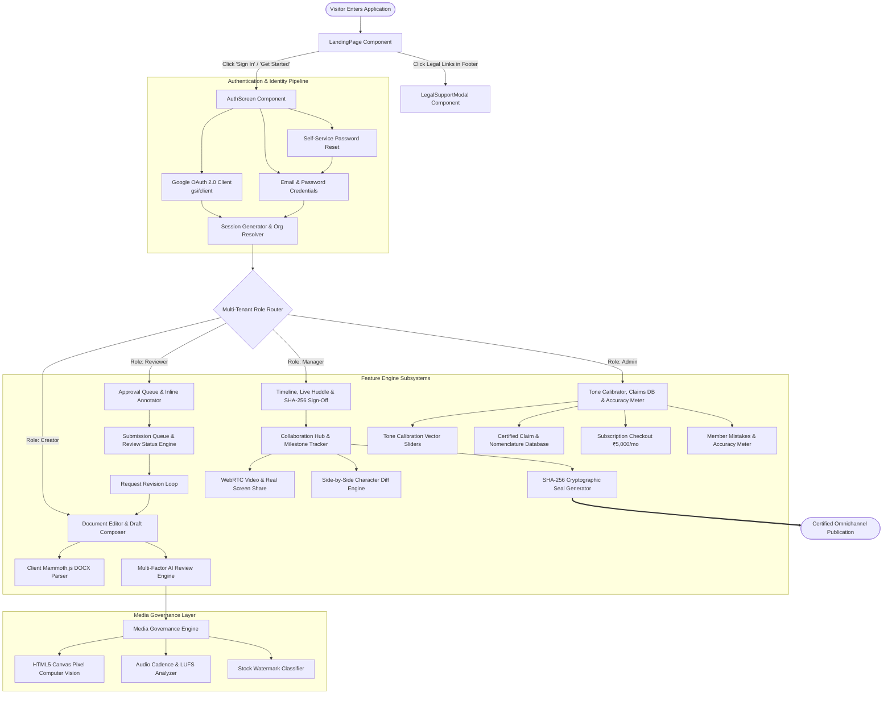
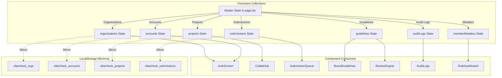
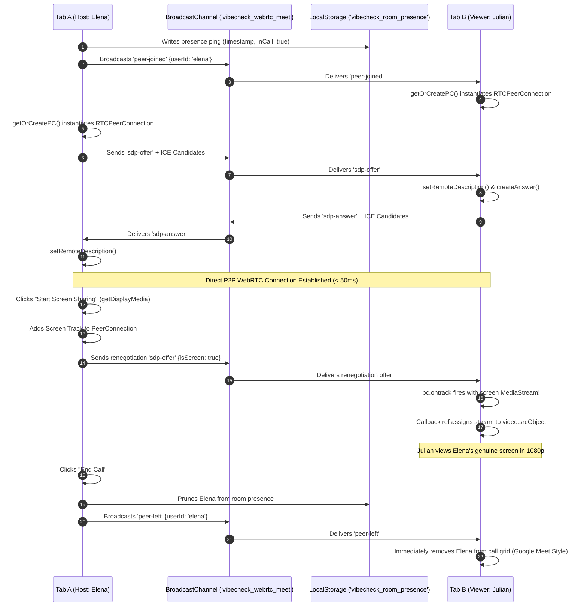
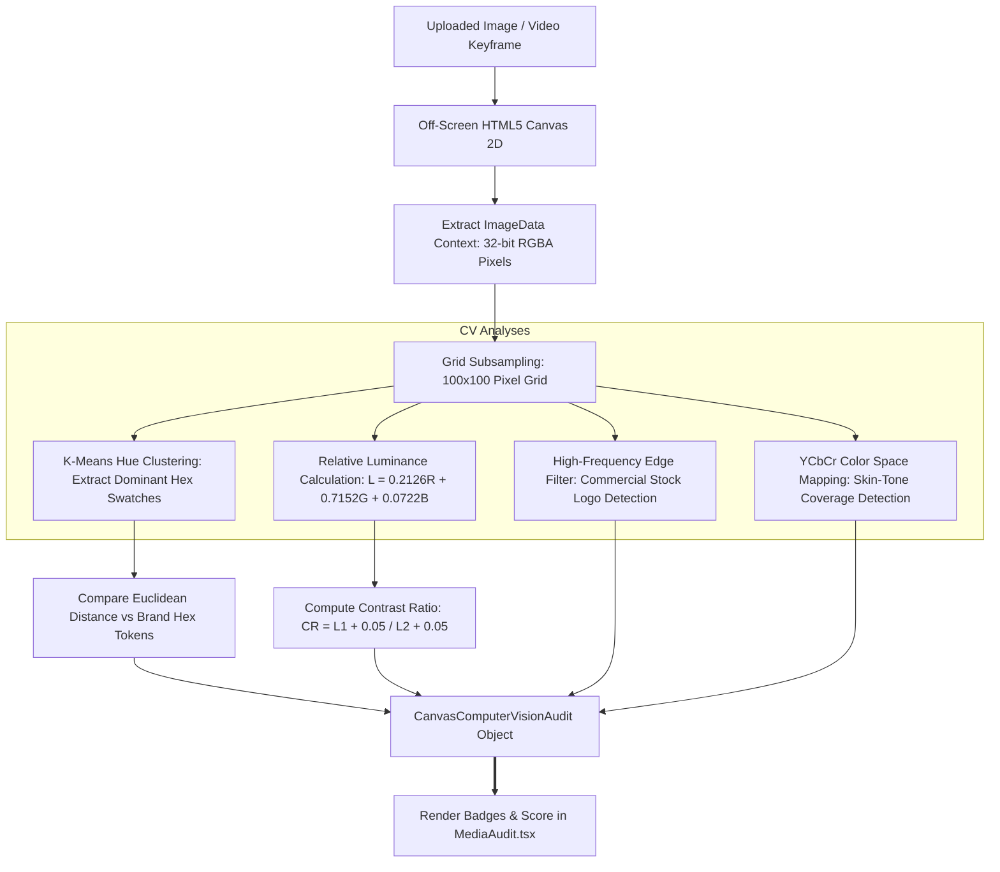

# System Architecture & Technical Specifications — VibeCheck AI

```
========================================================================================
  VIBECHECK AI — FULL SYSTEM ARCHITECTURE & COMPONENT INTEGRATION BLUEPRINT
  Document Version: 3.0.0 | Architecture: Next.js 14 App Router | Pattern: Multi-Tenant
========================================================================================
```

---

## 1. End-to-End Website Flow Architecture

The diagram below illustrates the comprehensive user journey, routing topology, and state transitions from public landing to certified omnichannel release:



---

## 2. Technology Stack Architecture

```
+--------------------------------------------------------------------------------------------------+
|                                  COMPLETE TECHNOLOGY STACK MATRIX                                |
+------------------+------------------------------+------------------------------------------------+
| Layer            | Primary Technology           | Architectural Role & Capabilities              |
+------------------+------------------------------+------------------------------------------------+
| Framework        | Next.js 14.2 (App Router)    | Hybrid RSC & Client Components, Route Handlers |
| UI Runtime       | React 18.3                   | State synchronization, Callback Refs, Contexts |
| Styling & Theme  | Tailwind CSS 3.4             | "Sandstone & Bronze" custom tokens, Responsive |
| Type Safety      | TypeScript 5.0 (Strict)      | Strict interfaces, type assertions, noImplicit |
| Icons & Visuals  | Lucide React                 | Clean vector typography without unicode emojis |
| Document Parsing | Mammoth.js (Client-Side)     | Native binary .docx to markdown conversion     |
| Real-Time Media  | Native Browser WebRTC        | RTCPeerConnection, STUN (Google), Local Streams|
| Screen Capture   | Screen Capture API           | navigator.mediaDevices.getDisplayMedia         |
| WebRTC Signaling | BroadcastChannel API         | Zero-dependency inter-tab WebRTC signaling     |
| Computer Vision  | HTML5 Canvas 2D Context      | Pixel luminance, Euclidean color distance, CV  |
| Cryptography     | Web Crypto API (SHA-256)     | Immutable managerial approval certificate seals|
| Identity Auth    | Google Identity Services     | OAuth 2.0 credential decoding & sign-in        |
| AI Gateway       | OpenRouter REST API          | Multi-LLM linguistic & compliance auditing     |
| Transaction Mail | Resend API                   | Automated transactional notifications          |
| Asset Storage    | Cloudinary Media CDN         | Scalable enterprise brand asset hosting        |
+------------------+------------------------------+------------------------------------------------+
```

```mermaid
graph LR
    subgraph Client-Side Presentation
        Next[Next.js 14 App Router]
        React[React 18 Engine]
        Tailwind[Tailwind CSS: Sandstone & Bronze]
        Lucide[Lucide React Vector Library]
    end

    subgraph Browser Hardware & Native APIs
        Canvas[HTML5 Canvas CV Engine]
        WebRTC[WebRTC RTCPeerConnection]
        Display[Screen Capture DisplayMedia API]
        Crypto[Web Crypto API SHA-256]
        BC[BroadcastChannel Signaling]
    end

    subgraph Serverless Backend & External APIs
        Routes[Next.js Node.js Route Handlers]
        OpenRouter[OpenRouter AI Multi-LLM Gateway]
        Google[Google OAuth 2.0 Identity Services]
        Cloudinary[Cloudinary Cloud Media CDN]
        Resend[Resend Transactional Email API]
    end

    Client-Side Presentation --> Browser Hardware & Native APIs
    Client-Side Presentation --> Serverless Backend & External APIs
```

---

## 3. Directory & Folder Structure Architecture

```mermaid
graph TD
    Root["/ (Project Root)"]
    Root --> Docs["Docs/ (Engineering & Product Documentation)"]
    Root --> Public["public/ (Static Assets & Favicons)"]
    Root --> Src["src/ (Application Source Code)"]

    Src --> App["app/ (Next.js App Router Core)"]
    Src --> Components["components/ (Modular UI Systems)"]
    Src --> Lib["lib/ (Engines, Types & Default Data)"]

    App --> AppApi["api/ (Serverless Route Handlers)"]
    App --> AppLayout["layout.tsx & globals.css"]
    App --> AppPage["page.tsx (Master State Orchestrator)"]

    AppApi --> ApiDocx["extract-docx/route.ts"]
    AppApi --> ApiReview["review/route.ts"]
    AppApi --> ApiImage["review-image/route.ts"]
    AppApi --> ApiAudio["transcribe-audio/route.ts"]
    AppApi --> ApiNotify["notify/route.ts"]
    AppApi --> ApiUpload["upload/route.ts"]

    Components --> CompAuth["AuthScreen.tsx"]
    Components --> CompEditor["DocumentEditor.tsx"]
    Components --> CompReview["ReviewEngine.tsx"]
    Components --> CompMedia["MediaAudit.tsx"]
    Components --> CompCollab["CollaborationHub.tsx"]
    Components --> CompQueue["SubmissionQueue.tsx"]
    Components --> CompDash["RoleDashboard.tsx"]
    Components --> CompBrand["BrandGuidelinesBuilder.tsx"]
    Components --> CompModals["Settings, Checkout & Legal Modals"]

    Lib --> LibCV["accessibility-cv.ts (Canvas CV Engine)"]
    Lib --> LibTypes["types.ts (Strict TypeScript Schemas)"]
    Lib --> LibData["default-data.ts (Initial Seeds)"]
    Lib --> LibClients["openrouter.ts, cloudinary.ts, resend.ts"]
```



```
c:\Users\kshit\Desktop\VibeCheck AI\
├── Docs/                                    # Architectural & Product Specifications
│   ├── PRD.md                               # Product Requirements Document
│   ├── Architecture.md                      # System Architecture & Topology
│   ├── Design.md                            # UI/UX Style Guide & Design System
│   ├── Task.md                              # Project Roadmap & Implementation Phases
│   ├── Database.md                          # Data Models, ERD & Persistence
│   ├── API.md                               # Serverless API Specifications
│   ├── Agents.md                            # Multi-Agent Compliance Pipeline
│   ├── Authentication &security.md          # Identity, RBAC & SHA-256 Signatures
│   ├── Integrations.md                      # External Integrations (Cloudinary, Resend)
│   ├── MCP connection.md                    # Model Context Protocol Specification
│   ├── Project Implementation.md            # Component Hierarchy & Implementation Map
│   ├── setup&initilisation.md               # Quickstart & Environment Setup
│   ├── Testing &QA.md                       # Quality Assurance & Test Strategy
│   └── Debugging.md                         # Troubleshooting & Diagnostic Runbook
├── public/                                  # Static Assets & Metadata
├── src/
│   ├── app/                                 # Next.js 14 App Router Directory
│   │   ├── api/                             # Serverless Node.js Route Handlers
│   │   │   ├── extract-docx/route.ts        # Mammoth.js DOCX Parsing Endpoint
│   │   │   ├── notify/route.ts              # Resend Transactional Email Endpoint
│   │   │   ├── review/route.ts              # Multi-Agent Text Compliance Endpoint
│   │   │   ├── review-image/route.ts        # Computer Vision Image Analysis Endpoint
│   │   │   ├── transcribe-audio/route.ts    # Speech-to-Text Transcription Endpoint
│   │   │   └── upload/route.ts              # Cloudinary Asset Upload Endpoint
│   │   ├── globals.css                      # Tailwind Directives & CSS Variable Scales
│   │   ├── layout.tsx                       # Root Layout with Google & Puter SDKs
│   │   └── page.tsx                         # Master State Orchestrator Component
│   ├── components/                          # Core Interactive React Components
│   │   ├── AnalyticsInsights.tsx            # Compliance Analytics & Trend Charts
│   │   ├── AssetLibrary.tsx                 # Brand Asset Storage & Tagging
│   │   ├── AuditLogs.tsx                    # Tamper-Proof Audit Trail Explorer
│   │   ├── AuthScreen.tsx                   # Google OAuth & Credential Sign-In / Reset
│   │   ├── BrandGuidelinesBuilder.tsx       # Tone Sliders & Certified Claim Editor
│   │   ├── CollaborationHub.tsx             # Milestone Tracker & WebRTC Huddle Room
│   │   ├── CookieConsentBanner.tsx          # GDPR/ePrivacy Compliance Banner
│   │   ├── DiffViewer.tsx                   # Side-by-Side Red/Green Diff Inspector
│   │   ├── DocumentEditor.tsx               # Rich Document Composer & DOCX Importer
│   │   ├── LandingPage.tsx                  # Public Marketing Showcase
│   │   ├── LegalSupportModal.tsx            # Interactive 5-Tab Legal Dialog
│   │   ├── MediaAudit.tsx                   # Audio Cadence, Video & Stock Watermark Scan
│   │   ├── Navbar.tsx                       # Workspace Navigation & Profile Bar
│   │   ├── ReviewEngine.tsx                 # Interactive Multi-Factor Content Review
│   │   ├── RoleDashboard.tsx                # Role-Specific Portals & Accuracy Meter
│   │   ├── SettingsModal.tsx                # Organization Key & User Preference Modal
│   │   ├── Sidebar.tsx                      # Primary Navigation Sidebar
│   │   ├── SubmissionQueue.tsx              # Editorial Queue with SHA-256 Sign-Off
│   │   └── SubscriptionCheckoutModal.tsx    # ₹5,000/mo Organization Billing Modal
│   └── lib/                                 # Core Engines, Types & Shared Utilities
│       ├── accessibility-cv.ts              # HTML5 Canvas Computer Vision Engine
│       ├── cloudinary.ts                    # Cloudinary SDK Configuration
│       ├── default-data.ts                  # Demo Organizations, Claims & Guidelines
│       ├── image-analysis.ts                # Client-Side Image Analysis Helpers
│       ├── openrouter.ts                    # OpenRouter LLM Gateway Client
│       ├── resend.ts                        # Resend Transactional Email Client
│       └── types.ts                         # Strict TypeScript Domain Schemas
├── .env.local                               # Private Local Environment Variables
├── package.json                             # Dependencies & Script Definitions
├── tailwind.config.ts                       # Tailwind Configuration & Sandstone Tokens
└── tsconfig.json                            # Strict TypeScript Compiler Options
```

---

## 4. Component Interconnectivity & Data Flow

### 4.1 Master State Orchestrator (`src/app/page.tsx`)
The master state orchestrator manages global data collections and isolates them per organization:



### 4.2 WebRTC Peer-to-Peer Stream & Signaling Architecture
The diagram below demonstrates how Tab A and Tab B exchange real screen streams and webcam video without external socket servers:



### 4.3 HTML5 Canvas Computer Vision Engine (`src/lib/accessibility-cv.ts`)
The client-side Computer Vision pipeline inspects graphic assets entirely in browser memory:



---

## 5. Security & Boundary Enforcement Architecture

```
+--------------------------------------------------------------------------------------------------+
|                                    SECURITY ARCHITECTURE OVERVIEW                                |
+------------------------+-------------------------------------+-----------------------------------+
| Security Layer         | Threat Mitigated                    | Defensive Implementation          |
+------------------------+-------------------------------------+-----------------------------------+
| Multi-Tenant Boundary  | Cross-organization data leakage     | Strict orgId scoping on all query |
|                        |                                     | selectors, mutations, and views   |
+------------------------+-------------------------------------+-----------------------------------+
| Non-Repudiation Proof  | Disputed approvals & alterations    | SHA-256 cryptographic digest of   |
|                        |                                     | content + timestamp + manager ID  |
+------------------------+-------------------------------------+-----------------------------------+
| Regulatory Defense     | FDA / FTC regulatory claim fines    | Hard-blocking claim validation    |
|                        |                                     | rule `RULE-CLAIM-EXCESS`          |
+------------------------+-------------------------------------+-----------------------------------+
| API Token Isolation    | Leakage of private provider keys    | Serverless route handlers isolate |
|                        |                                     | OpenRouter, Resend & Cloudinary   |
+------------------------+-------------------------------------+-----------------------------------+
| Memory Leak Defense    | Stale camera & screen tracks running| Explicit track termination loop on|
|                        | in background after call completion | call end and beforeunload event   |
+------------------------+-------------------------------------+-----------------------------------+
```
