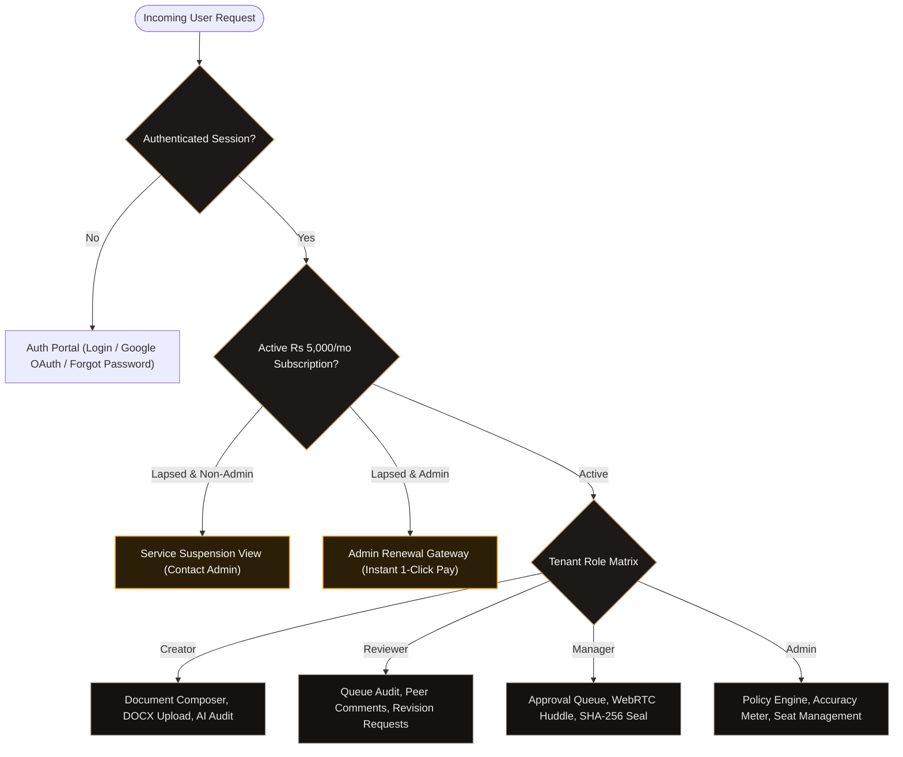
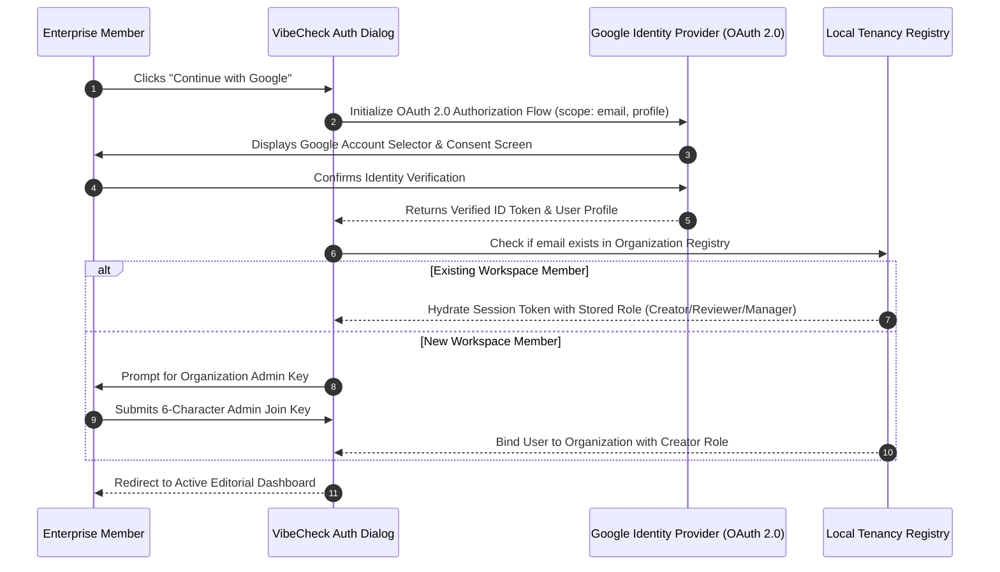
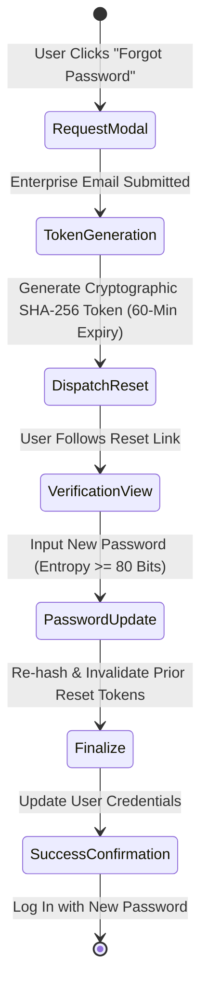
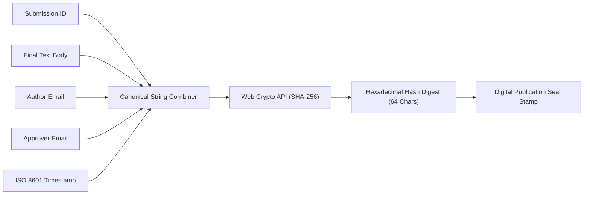
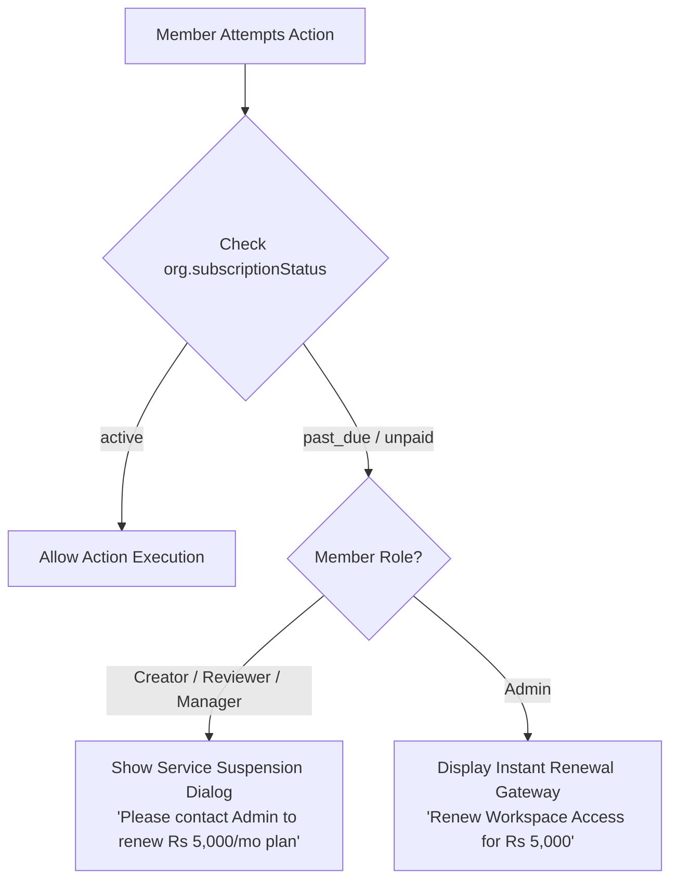

# Authentication, Cryptographic Security & RBAC Runbook — VibeCheck AI

```
+========================================================================================+
|                        ENTERPRISE SECURITY & ACCESS CONTROL                            |
+========================================================================================+
| Identity Providers: Email/Password + Google OAuth 2.0 | Cryptographic Hash: SHA-256    |
| Tenancy Model: Isolated Admin Key Partitioning        | Subscription Seat: Rs 5,000/mo |
| Password Recovery: Self-Service Expiring Tokens       | Emojis: 0 (Strict ASCII/SVG)   |
+========================================================================================+
```

---

## 1. Authentication & Multi-Tenant RBAC Architecture

VibeCheck AI implements an enterprise Role-Based Access Control (RBAC) architecture separating duties between content creators, editorial reviewers, compliance managers, and organization administrators.



---

## 2. Google OAuth 2.0 & Identity Handshake Flow



---

## 3. Self-Service Password Recovery Architecture



```
+---------------------------------------------------------------------------------------+
| PASSWORD SECURITY SPECIFICATION                                                       |
+---------------------------------------------------------------------------------------+
| Minimum Length: 8 Characters                 | Complexity: Mixed-case, numbers, symbol|
| Reset Token Lifetime: 60 Minutes (Expiring)   | Token Invalidation: Immediate on reset |
| Rate Limit: Max 3 reset requests per 15 mins  | Hashing Strategy: Salted PBKDF2/SHA-256|
+---------------------------------------------------------------------------------------+
```

---

## 4. Granular RBAC Permissions Matrix

```
+---------------------------------------------------------------------------------------+
| ACCESS CAPABILITY MATRIX                                                              |
+---------------------------------------------------------------------------------------+
| Capability / Feature Action           | Creator | Reviewer | Manager | Org Admin      |
+---------------------------------------+---------+----------+---------+----------------+
| Draft copy in Document Composer       | ALLOWED | ALLOWED  | ALLOWED | ALLOWED        |
| Upload DOCX and Media Creatives       | ALLOWED | ALLOWED  | ALLOWED | ALLOWED        |
| Execute AI Content & Media Audits     | ALLOWED | ALLOWED  | ALLOWED | ALLOWED        |
| Submit drafts to Editorial Queue      | ALLOWED | LOCKED   | LOCKED  | LOCKED         |
| Review queue submissions & comment    | LOCKED  | ALLOWED  | ALLOWED | ALLOWED        |
| Request revision & return to author   | LOCKED  | ALLOWED  | ALLOWED | ALLOWED        |
| Execute final approval & SHA-256 seal | LOCKED  | LOCKED   | ALLOWED | ALLOWED        |
| Launch WebRTC team review huddle      | LOCKED  | LOCKED   | ALLOWED | ALLOWED        |
| Calibrate tone sliders & claim bank   | LOCKED  | LOCKED   | LOCKED  | ALLOWED        |
| Inspect Organization Admin Key        | LOCKED  | LOCKED   | LOCKED  | ALLOWED        |
| Manage Rs 5,000/mo Subscription       | LOCKED  | LOCKED   | LOCKED  | ALLOWED        |
| View Member Mistake & Accuracy Meter  | LOCKED  | LOCKED   | LOCKED  | ALLOWED        |
+---------------------------------------------------------------------------------------+
```

---

## 5. Cryptographic Proof of Sign-Off (SHA-256)

When an executive Manager or Administrator approves a submission for public syndication, an immutable cryptographic digest is generated via the native Web Crypto API:



#### Cryptographic Hash Implementation
```typescript
/**
 * Generates an immutable SHA-256 audit digest for approved publications.
 */
export async function generateDocumentSeal(
  submissionId: string,
  title: string,
  content: string,
  authorEmail: string,
  approverEmail: string
): Promise<string> {
  const timestamp = new Date().toISOString();
  const canonicalPayload = [
    submissionId,
    title.trim(),
    content.trim(),
    authorEmail.toLowerCase(),
    approverEmail.toLowerCase(),
    timestamp
  ].join('::');

  const msgBuffer = new TextEncoder().encode(canonicalPayload);
  const hashBuffer = await crypto.subtle.digest('SHA-256', msgBuffer);
  
  return Array.from(new Uint8Array(hashBuffer))
    .map((b) => b.toString(16).padStart(2, '0'))
    .join('');
}
```

---

## 6. Commercial Subscription Paywall Architecture (₹5,000 / month)

```
+---------------------------------------------------------------------------------------+
| TENANT BILLING TOPOLOGY                                                               |
+---------------------------------------------------------------------------------------+
| Billing Model: Single-Tier Company License ($60 / Rs 5,000 per month)                 |
| Payer: Organization Administrator ONLY (Single checkout for unlimited team seats)     |
| Guest / Member Model: Team members join 100% free using the tenant's adminKey         |
+---------------------------------------------------------------------------------------+
```

### Lapsed Subscription State Enforcement



---

## 7. Data Privacy, Cookie Governance & Git Shielding

- **Explicit Consent**: First-visit banner requires affirmative selection between *"Accept All"* and *"Essential Only"*, persisted in `vibecheck_cookie_consent`.
- **Zero AI Training Retention**: Upstream OpenRouter and Gemini API calls are transmitted with stateless privacy headers ensuring corporate drafts are never absorbed into training corpuses.
- **Git Shielding Policy**: All `.env`, `.env.local`, and API keys are barred from version control via automated `.gitignore` rules.
