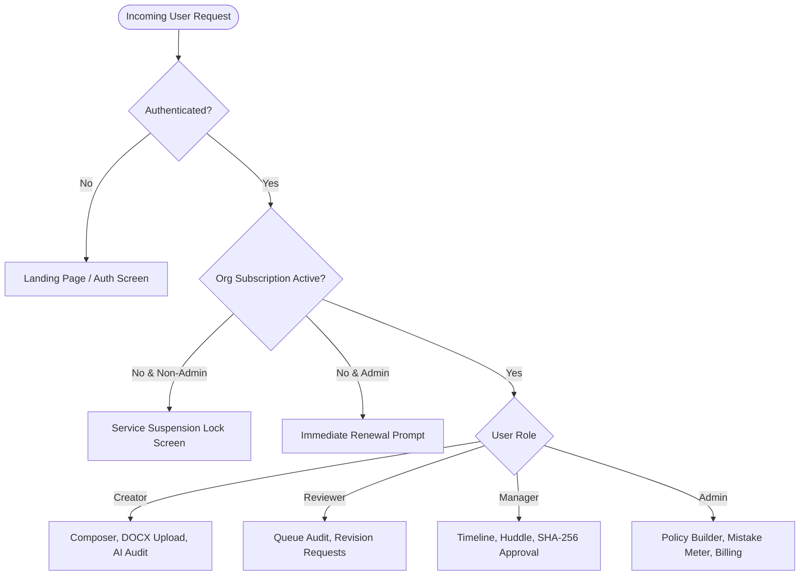

# Authentication, Security & Compliance Runbook — VibeCheck AI

## 1. Authentication & Multi-Tenant RBAC Architecture
VibeCheck AI uses an enterprise Role-Based Access Control (RBAC) model supporting four distinct roles:



---

## 2. Granular Permissions Matrix

| Feature / Action | Creator | Reviewer | Manager | Admin |
| :--- | :---: | :---: | :---: | :---: |
| Draft copy in Document Composer | ✅ | ✅ | ✅ | ✅ |
| Upload `.docx` and image assets | ✅ | ✅ | ✅ | ✅ |
| Execute AI Content & Media Audits | ✅ | ✅ | ✅ | ✅ |
| Submit drafts to Approval Queue | ✅ | ❌ | ❌ | ❌ |
| Review queue submissions & add comments | ❌ | ✅ | ✅ | ✅ |
| Request revision & return to creator | ❌ | ✅ | ✅ | ✅ |
| Execute final approval & SHA-256 seal | ❌ | ❌ | ✅ | ✅ |
| Launch WebRTC team review huddle | ❌ | ❌ | ✅ | ✅ |
| Calibrate tone sliders & claim database | ❌ | ❌ | ❌ | ✅ |
| View Organization Admin Key & Invites | ❌ | ❌ | ❌ | ✅ |
| Pay ₹5,000/mo Organization Subscription | ❌ | ❌ | ❌ | ✅ |
| View Member Mistakes & Accuracy Meter | ❌ | ❌ | ❌ | ✅ |

---

## 3. Subscription Paywall & Service Suspension Architecture (₹5,000 / month)

### 3.1 Single-Seat Company Billing
- **Only the Company Admin Pays**: When creating a new company organization, the Admin initiates a ₹5,000 / month subscription.
- **Team Joins 100% Free**: Team members (Creators, Reviewers, Managers) never pay; they simply supply the organization's unique `adminKey` during registration.

### 3.2 Organization-Wide Service Suspension
- If the monthly subscription lapses or enters `'unpaid'` / `'past_due'` status:
  - **Creators, Reviewers, and Managers** are immediately locked out of active workspace features. They see a polite suspension screen informing them: *"Your company workspace requires an active ₹5,000/month subscription. Only your organization Admin (admin@company.com) has to pay to restore workspace access."*
  - **The Admin** sees a high-priority banner with an immediate **"Renew ₹5,000 Plan"** button that opens `SubscriptionCheckoutModal` to restore access in one click.

---

## 4. Cryptographic Proof of Sign-Off (SHA-256)
When a Manager or Admin approves a content submission:
1. Canonical content string is formed: `title + currentText + author.email + approvedAt + signerEmail`.
2. SHA-256 digest is generated via Web Crypto API:
   ```ts
   const canonicalPayload = `${submission.id}:${submission.title}:${submission.currentText}:${submission.author.email}:${new Date().toISOString()}:${currentUser.email}`;
   const msgBuffer = new TextEncoder().encode(canonicalPayload);
   const hashBuffer = await crypto.subtle.digest('SHA-256', msgBuffer);
   const hashHex = Array.from(new Uint8Array(hashBuffer))
     .map((b) => b.toString(16).padStart(2, '0'))
     .join('');
   ```
3. The cryptographic signature is attached to the submission record, producing an immutable audit receipt.

---

## 5. Privacy, Cookies & Data Sovereignty
- **Mandatory Terms Checkbox**: Registration requires positive verification of *"I accept terms & conditions and privacy policy"*.
- **Cookie Consent**: First-visit banner provides explicit **Accept All** and **Reject Non-Essential** options, with consent persisted in `localStorage`.
- **Zero Content Retention**: LLM review payloads carry no persistent training rights under enterprise API agreements.
- **Git Shielding**: `.gitignore` strictly ignores `.env`, `.env.local`, and credential files to prevent accidental leakage to GitHub.
