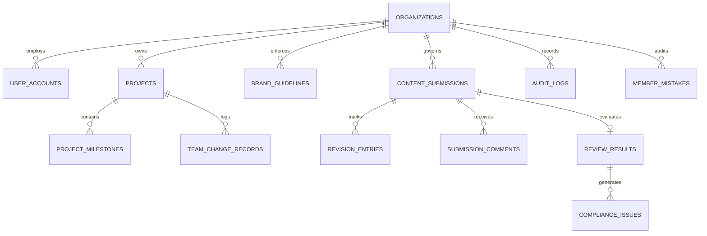

# Database Schema, Entity Modeling & Multi-Tenant Partitioning — VibeCheck AI

```
+========================================================================================+
|                        DATABASE & DATA PERSISTENCE SPECIFICATION                       |
+========================================================================================+
| Relational Target: PostgreSQL 16 + RLS          | Client Store: Reactive LocalStorage  |
| Tenancy Partitioning: org_id Isolation          | Foreign Keys: Cascade Referencing    |
| Audit Trail: Immutable SHA-256 Hashes           | Emojis: 0 (Strict ASCII/SVG)         |
+========================================================================================+
```

---

## 1. Domain Modeling Philosophy

VibeCheck AI uses strict TypeScript domain models (`src/lib/types.ts`) that mirror enterprise relational database tables. Every transaction, submission, and audit event belongs to a single organization tenant identified by `org_id`. In server-backed environments, Row Level Security (RLS) guarantees complete tenant boundary enforcement.

---

## 2. Complete Entity-Relationship Diagram (ERD)



---

## 3. Data Dictionary & Table Specifications

### 3.1 Table: `organizations` (Tenant Partition Root)

```
+---------------------------------------------------------------------------------------+
| TABLE: organizations                                                                  |
+---------------------------------------------------------------------------------------+
| Partition Key: id (PK) | Billing Seat: Rs 5,000 / month | Scope: Global Multi-Tenant  |
+---------------------------------------------------------------------------------------+
```

| Column | Type | Nullable | Constraints / Default | Description |
| :--- | :--- | :---: | :---: | :--- |
| `id` | `VARCHAR(64)` | NO | PRIMARY KEY | Unique tenant ID (`org_lumina`) |
| `name` | `VARCHAR(255)` | NO | NOT NULL | Registered company / brand name |
| `admin_key` | `VARCHAR(64)` | NO | UNIQUE | 6-character team onboarding key |
| `admin_id` | `VARCHAR(64)` | NO | FK to `user_accounts` | Lead administrator identifier |
| `admin_email` | `VARCHAR(255)` | NO | NOT NULL | Primary billing contact address |
| `subscription_status` | `VARCHAR(32)` | NO | `'active'` | `'active'`, `'past_due'`, `'unpaid'`, `'canceled'` |
| `subscription_price` | `NUMERIC(10,2)`| NO | `5000.00` | Flat monthly company fee (INR ₹5,000) |
| `billing_cycle` | `VARCHAR(32)` | NO | `'monthly'` | Standard billing cadence |
| `next_billing_date` | `TIMESTAMPTZ` | YES | NULL | Next billing renewal timestamp |
| `created_at` | `TIMESTAMPTZ` | NO | `NOW()` | Organization creation timestamp |

---

### 3.2 Table: `user_accounts` (Enterprise Identity)

```
+---------------------------------------------------------------------------------------+
| TABLE: user_accounts                                                                  |
+---------------------------------------------------------------------------------------+
| Foreign Key: org_id -> organizations.id | RBAC: Admin, Manager, Reviewer, Creator     |
+---------------------------------------------------------------------------------------+
```

| Column | Type | Nullable | Constraints / Default | Description |
| :--- | :--- | :---: | :---: | :--- |
| `id` | `VARCHAR(64)` | NO | PRIMARY KEY | User account identifier (`usr_*`) |
| `org_id` | `VARCHAR(64)` | NO | FK `organizations.id` | Multi-tenant isolation boundary |
| `name` | `VARCHAR(255)` | NO | NOT NULL | Full member display name |
| `email` | `VARCHAR(255)` | NO | UNIQUE NOT NULL | Corporate email address |
| `role` | `VARCHAR(32)` | NO | NOT NULL | `'admin'`, `'manager'`, `'reviewer'`, `'creator'` |
| `password_hash` | `VARCHAR(255)` | NO | NOT NULL | Salted PBKDF2/SHA-256 hash |
| `avatar_url` | `VARCHAR(512)` | YES | NULL | Profile image link / Data URI |
| `created_at` | `TIMESTAMPTZ` | NO | `NOW()` | Registration timestamp |

---

### 3.3 Table: `projects` (Campaign Workspaces)

```
+---------------------------------------------------------------------------------------+
| TABLE: projects                                                                       |
+---------------------------------------------------------------------------------------+
| Lifecycle: just_started -> in_progress -> under_review -> revisions -> completed      |
+---------------------------------------------------------------------------------------+
```

| Column | Type | Nullable | Default | Description |
| :--- | :--- | :---: | :---: | :--- |
| `id` | `VARCHAR(64)` | NO | PRIMARY KEY | Project identifier (`proj_*`) |
| `org_id` | `VARCHAR(64)` | NO | FK `organizations.id` | Multi-tenant partition key |
| `title` | `VARCHAR(255)` | NO | NOT NULL | Campaign name |
| `description` | `TEXT` | NO | NOT NULL | Strategic campaign brief |
| `status` | `VARCHAR(32)` | NO | `'just_started'` | Workflow lifecycle stage |
| `progress_percent`| `INTEGER` | NO | `0` | Calculated completion (0–100) |
| `target_deadline` | `DATE` | NO | NOT NULL | Hard delivery deadline |
| `assigned_creators`| `TEXT[]` | NO | `ARRAY[]::TEXT[]` | Assigned author user IDs |
| `assigned_reviewers`| `TEXT[]`| NO | `ARRAY[]::TEXT[]` | Assigned compliance reviewer user IDs |

---

### 3.4 Table: `content_submissions` (Editorial Pipeline)

```
+---------------------------------------------------------------------------------------+
| TABLE: content_submissions                                                            |
+---------------------------------------------------------------------------------------+
| Verification: sha256_signature | Status: draft -> in_review -> needs_revision -> ok   |
+---------------------------------------------------------------------------------------+
```

| Column | Type | Nullable | Default | Description |
| :--- | :--- | :---: | :---: | :--- |
| `id` | `VARCHAR(64)` | NO | PRIMARY KEY | Submission record ID (`sub_*`) |
| `org_id` | `VARCHAR(64)` | NO | FK `organizations.id` | Multi-tenant partition key |
| `title` | `VARCHAR(255)` | NO | NOT NULL | Editorial headline or title |
| `format` | `VARCHAR(32)` | NO | `'ad_copy'` | `'ad_copy'`, `'social_media'`, `'docx'`, `'image'` |
| `raw_text` | `TEXT` | NO | NOT NULL | Initial author draft copy |
| `current_text` | `TEXT` | NO | NOT NULL | Latest revised content |
| `status` | `VARCHAR(32)` | NO | `'draft'` | Pipeline status |
| `version` | `INTEGER` | NO | `1` | Incrementing revision counter |
| `sha256_signature`| `VARCHAR(64)` | YES | NULL | Cryptographic publication digest |
| `signed_by_email` | `VARCHAR(255)` | YES | NULL | Certifying Manager/Admin email |
| `signed_at` | `TIMESTAMPTZ` | YES | NULL | Timestamp of final certification |

---

### 3.5 Table: `member_mistakes` (Executive Mistake Meter)

```
+---------------------------------------------------------------------------------------+
| TABLE: member_mistakes                                                                |
+---------------------------------------------------------------------------------------+
| Metrics: Category attribution, frequency score, and training recommendations          |
+---------------------------------------------------------------------------------------+
```

| Column | Type | Nullable | Default | Description |
| :--- | :--- | :---: | :---: | :--- |
| `id` | `VARCHAR(64)` | NO | PRIMARY KEY | Error record ID (`mst_*`) |
| `org_id` | `VARCHAR(64)` | NO | FK `organizations.id` | Tenant partition key |
| `user_id` | `VARCHAR(64)` | NO | FK `user_accounts.id` | Flagged author ID |
| `user_name` | `VARCHAR(255)` | NO | NOT NULL | Flagged author display name |
| `category` | `VARCHAR(32)` | NO | NOT NULL | `'grammar'`, `'tone'`, `'claims'`, `'spelling'` |
| `severity` | `VARCHAR(32)` | NO | `'major'` | `'critical'`, `'major'`, `'minor'` |
| `flagged_text` | `TEXT` | NO | NOT NULL | Defective text string |
| `correction` | `TEXT` | NO | NOT NULL | Compliant approved alternative |
| `created_at` | `TIMESTAMPTZ` | NO | `NOW()` | Timestamp recorded |

---

## 4. Client-Side LocalStorage Mirror Architecture

During standalone and offline-capable sessions, the state manager mirrors PostgreSQL relational tables into segregated browser `localStorage` slots prefixed by tenant context:

```
+---------------------------------------------------------------------------------------+
| LOCALSTORAGE TENANT STORAGE TOPOLOGY                                                  |
+---------------------------------------------------------------------------------------+
| Key Path                                  | Schema Representation                     |
+-------------------------------------------+-------------------------------------------+
| vibecheck_current_user                    | Active authenticated user session token   |
| vibecheck_users                           | user_accounts[] array registry            |
| vibecheck_organizations                   | organizations[] tenant catalog            |
| vibecheck_projects                        | projects[] campaign repository            |
| vibecheck_submissions                     | content_submissions[] document queue      |
| vibecheck_member_mistakes                 | member_mistakes[] error attribution records|
| vibecheck_brand_guidelines                | Tenant brand voice rules & claim bank     |
| vibecheck_cookie_consent                  | Affirmative user cookie preferences       |
+---------------------------------------------------------------------------------------+
```

---

## 5. PostgreSQL Performance Indexes & RLS Implementation

```sql
-- Multi-Tenant Partitioning Performance Indexes
CREATE INDEX idx_user_accounts_org ON user_accounts(org_id);
CREATE INDEX idx_projects_org ON projects(org_id);
CREATE INDEX idx_content_submissions_org ON content_submissions(org_id);
CREATE INDEX idx_content_submissions_status ON content_submissions(status);
CREATE INDEX idx_member_mistakes_org ON member_mistakes(org_id);
CREATE INDEX idx_member_mistakes_user ON member_mistakes(user_id);

-- Enforce Strict Tenant Isolation via Row Level Security (RLS)
ALTER TABLE organizations ENABLE ROW LEVEL SECURITY;
ALTER TABLE user_accounts ENABLE ROW LEVEL SECURITY;
ALTER TABLE projects ENABLE ROW LEVEL SECURITY;
ALTER TABLE content_submissions ENABLE ROW LEVEL SECURITY;
ALTER TABLE member_mistakes ENABLE ROW LEVEL SECURITY;

CREATE POLICY tenant_isolation_submissions ON content_submissions
  FOR ALL
  USING (org_id = current_setting('app.current_org_id', true));

CREATE POLICY tenant_isolation_mistakes ON member_mistakes
  FOR ALL
  USING (org_id = current_setting('app.current_org_id', true));
```
