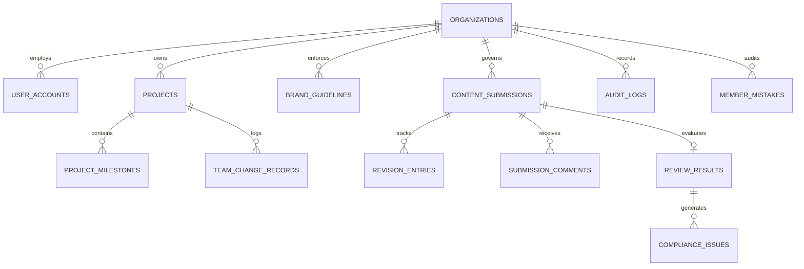

# Database Schema & Data Models Specification — VibeCheck AI

## 1. Domain Modeling Philosophy
VibeCheck AI uses strict TypeScript domain models in `src/lib/types.ts` that mirror relational database tables. In enterprise production, these models map directly to PostgreSQL tables with Row Level Security (RLS) enabled on `org_id`.

---

## 2. Complete Entity-Relationship Diagram (ERD)



---

## 3. Detailed Table & Schema Specifications

### 3.1 Table: `organizations`
Primary multi-tenant entity representing the subscribing enterprise.

| Column | Type | Nullable | Default | Description |
| :--- | :--- | :---: | :---: | :--- |
| `id` | `VARCHAR(64)` | NO | Primary Key | Format: `org_*` (e.g. `org_lumina`) |
| `name` | `VARCHAR(255)` | NO | - | Company or institution name |
| `admin_key` | `VARCHAR(64)` | NO | UNIQUE | Organization invite key for team onboarding |
| `admin_id` | `VARCHAR(64)` | NO | - | Foreign key to `user_accounts.id` (Admin user) |
| `admin_email` | `VARCHAR(255)` | NO | - | Primary billing contact email |
| `subscription_status` | `VARCHAR(32)` | NO | `'active'` | `'active'`, `'past_due'`, `'unpaid'`, `'canceled'` |
| `subscription_price` | `NUMERIC(10,2)`| NO | `5000.00` | Flat monthly price in INR (₹5,000) |
| `billing_cycle` | `VARCHAR(32)` | NO | `'monthly'` | Fixed monthly billing frequency |
| `next_billing_date` | `TIMESTAMPTZ` | YES | NULL | Next billing renewal timestamp |
| `last_payment_txn_id` | `VARCHAR(128)`| YES | NULL | Payment gateway transaction ID |
| `created_at` | `TIMESTAMPTZ` | NO | `NOW()` | Organization creation timestamp |

### 3.2 Table: `user_accounts`
Users belonging to an organization with role-based access.

| Column | Type | Nullable | Default | Description |
| :--- | :--- | :---: | :---: | :--- |
| `id` | `VARCHAR(64)` | NO | Primary Key | Format: `usr_*` |
| `org_id` | `VARCHAR(64)` | NO | FK `organizations.id` | Multi-tenant partition key |
| `org_name` | `VARCHAR(255)` | NO | - | Cached organization name |
| `name` | `VARCHAR(255)` | NO | - | Full user name |
| `email` | `VARCHAR(255)` | NO | UNIQUE | Sign-in email address |
| `role` | `VARCHAR(32)` | NO | - | `'admin'`, `'manager'`, `'reviewer'`, `'creator'` |
| `password` | `VARCHAR(255)` | NO | - | Hashed credential string |
| `avatar` | `VARCHAR(512)` | YES | NULL | Avatar URL or data URI |
| `created_at` | `TIMESTAMPTZ` | NO | `NOW()` | Account creation date |

### 3.3 Table: `projects`
Collaborative campaigns containing timelines, milestones, and assigned members.

| Column | Type | Nullable | Default | Description |
| :--- | :--- | :---: | :---: | :--- |
| `id` | `VARCHAR(64)` | NO | Primary Key | Format: `proj_*` |
| `org_id` | `VARCHAR(64)` | NO | FK `organizations.id` | Multi-tenant partition key |
| `title` | `VARCHAR(255)` | NO | - | Project or campaign title |
| `description` | `TEXT` | NO | - | Strategic campaign brief |
| `status` | `VARCHAR(32)` | NO | `'just_started'` | `'just_started'`, `'in_progress'`, `'under_review'`, `'revisions'`, `'completed'` |
| `progress_percent`| `INTEGER` | NO | `0` | Calculated milestone completion (0-100) |
| `start_date` | `DATE` | NO | - | Project kickoff date |
| `target_deadline` | `DATE` | NO | - | Target delivery deadline |
| `assigned_creators`| `TEXT[]` | NO | `[]` | Array of `user_accounts.id` (Creators) |
| `assigned_reviewers`|`TEXT[]` | NO | `[]` | Array of `user_accounts.id` (Reviewers) |
| `channels` | `TEXT[]` | NO | `[]` | Publication channels (`LinkedIn`, `YouTube`, etc.) |
| `tags` | `TEXT[]` | NO | `[]` | Categorical tags |

### 3.4 Table: `content_submissions`
Content drafts flowing through the editorial and compliance pipeline.

| Column | Type | Nullable | Default | Description |
| :--- | :--- | :---: | :---: | :--- |
| `id` | `VARCHAR(64)` | NO | Primary Key | Format: `sub_*` |
| `org_id` | `VARCHAR(64)` | NO | FK `organizations.id` | Multi-tenant partition key |
| `title` | `VARCHAR(255)` | NO | - | Content document title |
| `format` | `VARCHAR(32)` | NO | - | `'ad_copy'`, `'social_media'`, `'docx'`, `'image'`, etc. |
| `raw_text` | `TEXT` | NO | - | Initial submitted draft content |
| `current_text` | `TEXT` | NO | - | Active revised content |
| `channel` | `VARCHAR(128)` | NO | - | Intended publication channel |
| `target_audience` | `VARCHAR(128)` | NO | - | Target demographic |
| `status` | `VARCHAR(32)` | NO | `'draft'` | `'draft'`, `'in_review'`, `'needs_revision'`, `'approved'` |
| `version` | `INTEGER` | NO | `1` | Incrementing revision counter |
| `sha256_signature`| `VARCHAR(64)` | YES | NULL | Cryptographic sign-off hash |
| `signed_at` | `TIMESTAMPTZ` | YES | NULL | Timestamp of sign-off |
| `signed_by_email` | `VARCHAR(255)` | YES | NULL | Signer email address |

### 3.5 Table: `member_mistakes`
Individual error attribution records used for the Admin Member Mistakes & Accuracy Meter.

| Column | Type | Nullable | Default | Description |
| :--- | :--- | :---: | :---: | :--- |
| `id` | `VARCHAR(64)` | NO | Primary Key | Format: `mst_*` |
| `org_id` | `VARCHAR(64)` | NO | FK `organizations.id` | Multi-tenant partition key |
| `user_id` | `VARCHAR(64)` | NO | FK `user_accounts.id` | Flagged author ID |
| `user_name` | `VARCHAR(255)` | NO | - | Flagged author name |
| `category` | `VARCHAR(32)` | NO | - | `'grammar'`, `'tone'`, `'claims'`, `'spelling'`, `'terminology'` |
| `severity` | `VARCHAR(32)` | NO | `'major'` | `'critical'`, `'major'`, `'minor'` |
| `flagged_text` | `TEXT` | NO | - | Verbatim draft text with violation |
| `correction` | `TEXT` | NO | - | Guideline-approved correction |
| `created_at` | `TIMESTAMPTZ` | NO | `NOW()` | Timestamp recorded |

---

## 4. PostgreSQL Indexes & RLS Policies
```sql
-- Index on multi-tenant partition key for sub-millisecond lookups
CREATE INDEX idx_user_accounts_org ON user_accounts(org_id);
CREATE INDEX idx_projects_org ON projects(org_id);
CREATE INDEX idx_content_submissions_org ON content_submissions(org_id);
CREATE INDEX idx_member_mistakes_org ON member_mistakes(org_id);

-- Row Level Security (RLS) Policy Example
ALTER TABLE content_submissions ENABLE ROW LEVEL SECURITY;

CREATE POLICY org_isolation_policy ON content_submissions
  FOR ALL
  USING (org_id = current_setting('app.current_org_id'));
```
