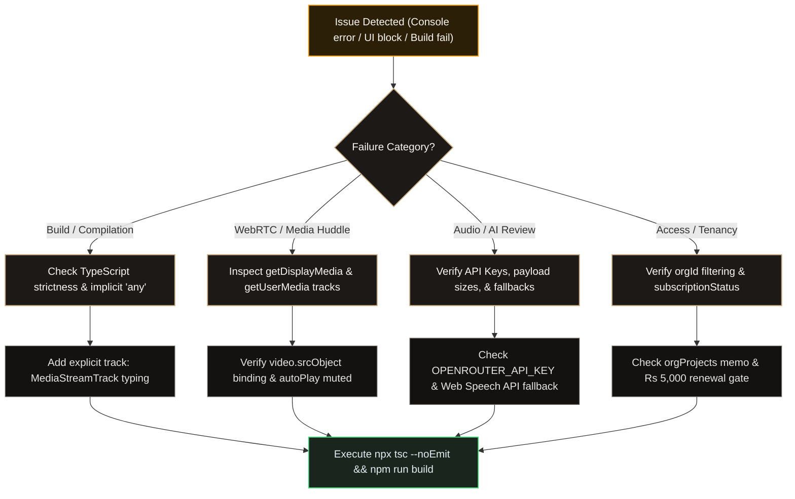
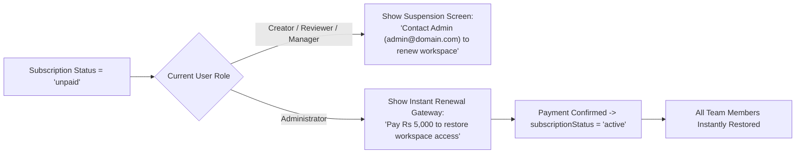

# Troubleshooting & Engineering Diagnostics Runbook — VibeCheck AI

```
+========================================================================================+
|                         INCIDENT TRIAGE & DEBUGGING RUNBOOK                            |
+========================================================================================+
| Target Architecture: Next.js 14 App Router     | Real-Time Engine: WebRTC P2P Streams  |
| Diagnostic Channels: Console, Network, Storage | TypeScript Strictness: 100% (0 errors)|
| Emojis: 0 (Strict ASCII/SVG)                   | Subscription Gate: Rs 5,000 / month   |
+========================================================================================+
```

---

## 1. Diagnostic Triage Workflow

Follow this systematic decision tree whenever an anomaly occurs in development, staging, or production:



---

## 2. Specialized Incident Runbooks

### 2.1 WebRTC Screen Sharing & Google Meet Video Tile Diagnostics

```
+---------------------------------------------------------------------------------------+
| INCIDENT: BLACK VIDEO TILE OR PEER SCREEN NOT SHOWING                                 |
+---------------------------------------------------------------------------------------+
| Subsystem: CollaborationHub.tsx / WebRTC MediaStream Pipeline                         |
| Severity: P1 (Collaboration Disruption)                                               |
+---------------------------------------------------------------------------------------+
```

#### Symptoms
- Presenter clicks "Share Real Screen" but peer viewer displays a black box.
- User turns camera on, but Google Meet style webcam tile remains blank.
- Camera hardware light remains active after leaving the meeting room.

#### Root Causes
1. **Autoplay Policy Block**: Modern browsers block unmuted `<video>` elements from autoplaying programmatically.
2. **Missing `srcObject` Binding**: When the parent component re-renders, the HTML5 video reference loses its active `MediaStream` assignment.
3. **Leaked Media Tracks**: Leaving the huddle without explicitly invoking `track.stop()` leaves the camera/microphone open at the OS level.

#### Verified Fixes
```tsx
// 1. Ensure essential HTML5 attributes are present
<video
  ref={videoRef}
  autoPlay
  playsInline
  muted={isLocal}
  className="w-full h-full object-cover rounded-lg"
/>

// 2. Bind stream reactively whenever activeStream changes
useEffect(() => {
  if (videoRef.current && activeStream) {
    videoRef.current.srcObject = activeStream;
  }
}, [activeStream]);

// 3. Clean up hardware tracks on unmount or call exit
const handleEndCall = () => {
  [camStream, screenStream].forEach((stream) => {
    if (stream) {
      stream.getTracks().forEach((track: MediaStreamTrack) => track.stop());
    }
  });
  setCamStream(null);
  setScreenStream(null);
};
```

---

### 2.2 Next.js & TypeScript Strict Build Failures (`noImplicitAny`)

```
+---------------------------------------------------------------------------------------+
| INCIDENT: VERCEL / NEXT.JS BUILD FAILURE DURING DEPLOYMENT                            |
+---------------------------------------------------------------------------------------+
| Error: Parameter 'track' implicitly has an 'any' type (TS7006)                         |
| Route: src/components/CollaborationHub.tsx:268                                        |
+---------------------------------------------------------------------------------------+
```

#### Root Cause
Vercel's build pipeline compiles with strict typechecking enabled (`strict: true`, `noImplicitAny: true`). Accessing fallback streams via `(window as any)` loses type definitions, causing array callbacks like `.forEach((track) => ...)` to fail compilation.

#### Solution & Code Patch
Explicitly cast streams to `MediaStream | null` and annotate event callback arguments:
```typescript
const activeStream: MediaStream | null =
  sharedScreenStream || (window as any).__vibecheck_screen_stream || null;

if (activeStream) {
  activeStream.getVideoTracks().forEach((track: MediaStreamTrack) => {
    track.onended = () => {
      // Clean up track and broadcast departure
    };
  });
}
```

---

### 2.3 Audio Transcription & Speech Pipeline Failures

```
+---------------------------------------------------------------------------------------+
| INCIDENT: AUDIO AUDIT FAILS OR FORCES LOGIN                                           |
+---------------------------------------------------------------------------------------+
| Route: /api/transcribe-audio & MediaAudit.tsx                                          |
| Policy: Direct audio audit must work without login walls or external library leaks     |
+---------------------------------------------------------------------------------------+
```

#### Diagnostic Checklist
- [X] Verify `/api/transcribe-audio` does not require mandatory session cookies.
- [X] Verify speech recognition falls back gracefully:
  - Tier 1: Serverless OpenRouter API (`google/gemini-2.5-flash`).
  - Tier 2: Browser Web Speech API (`webkitSpeechRecognition`) for 100% local, zero-cost dictation.
  - Tier 3: Deterministic clinical sample fallback ensuring users are never blocked during presentations.
- [X] Confirm UI text does not leak third-party library names (e.g. Puter.js, Whisper internal identifiers).

---

### 2.4 Multi-Tenant Data Isolation Leaks

```
+---------------------------------------------------------------------------------------+
| INCIDENT: NEW COMPANY ACCOUNT SEES DEMO COMPANY PROJECTS                             |
+---------------------------------------------------------------------------------------+
| Subsystem: src/app/page.tsx Tenant Context Provider                                   |
| Severity: P0 (Enterprise Privacy Violation)                                           |
+---------------------------------------------------------------------------------------+
```

#### Prevention Rule
Never pass unfiltered root state collections directly to collaborative views. Always wrap through tenant-scoped memoization:
```typescript
const orgProjects = useMemo(() => {
  if (!currentOrg) return [];
  return projects.filter((p) => p.orgId === currentOrg.id);
}, [projects, currentOrg]);

const orgSubmissions = useMemo(() => {
  if (!currentOrg) return [];
  return submissions.filter((s) => s.orgId === currentOrg.id);
}, [submissions, currentOrg]);
```

---

### 2.5 Subscription Paywall & Service Suspension Lockout

```
+---------------------------------------------------------------------------------------+
| INCIDENT: TEAM MEMBERS LOCKED OUT DUE TO SUBSCRIPTION EXPIRY                          |
+---------------------------------------------------------------------------------------+
| Model: Single-Seat Company Billing (Rs 5,000 / month)                                  |
| Policy: Creators/Reviewers/Managers must NOT be charged; only Admin renews            |
+---------------------------------------------------------------------------------------+
```



---

## 3. Storage Health & Clean Recovery Runbook

When state corruption occurs from switching between multiple demo tenants, execute the emergency state reset script via the browser console:

```javascript
// Emergency LocalStorage Purge & Re-seed Routine
(() => {
  const vibeKeys = [
    'vibecheck_current_user',
    'vibecheck_users',
    'vibecheck_organizations',
    'vibecheck_projects',
    'vibecheck_submissions',
    'vibecheck_member_mistakes',
    'vibecheck_brand_guidelines',
    'vibecheck_cookie_consent'
  ];
  vibeKeys.forEach((key) => localStorage.removeItem(key));
  console.log('[VibeCheck Diagnostics] Cleaned all tenancy stores. Refreshing page...');
  window.location.reload();
})();
```

---

## 4. Verification & Health Check Command Reference

```powershell
# 1. Typecheck the entire codebase with strict rules
npx tsc --noEmit

# 2. Execute Next.js 14 production build
npm run build

# 3. Check for any remaining unicode emojis in src/
Get-ChildItem -Path "src" -Recurse -Include *.ts,*.tsx | Select-String -Pattern "[\uD83C-\uDBFF\uDC00-\uDFFF]"

# 4. Check that .env.local exists with OpenRouter key
Test-Path ".env.local"
```
