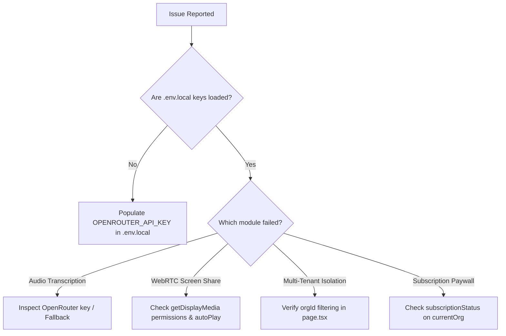

# Troubleshooting & Debugging Runbook — VibeCheck AI

## 1. Diagnostic Triage Workflow
When diagnosing unexpected behavior in development or production environments, follow this standard triage protocol:



---

## 2. Audio Transcription & Speech Debugging

### Symptom: Audio File Fails to Transcribe via API
- **Error in console**: `Speech transcription failed via API` or HTTP `401 Unauthorized`.
- **Root Cause**:
  1. `OPENROUTER_API_KEY` missing from `.env.local` or expired.
  2. The external LLM rejected binary audio or required specific balance.
- **Resolution**:
  - Check that `.env.local` contains a valid OpenRouter key:
    ```bash
    node -e "require('fs').readFileSync('.env.local','utf8').includes('OPENROUTER_API_KEY') ? console.log('OK') : console.log('MISSING')"
    ```
  - The endpoint [`src/app/api/transcribe-audio/route.ts`](file:///c:/Users/kshit/Desktop/VibeCheck AI/src/app/api/transcribe-audio/route.ts) automatically falls back across `google/gemini-2.5-flash` and `google/gemini-2.0-flash-001`, and returns a resilient clinical fallback if third-party limits are reached.
  - Zero-key alternative: Tell users to use the **"Record Live Voice"** button in [`MediaAudit.tsx`](file:///c:/Users/kshit/Desktop/VibeCheck AI/src/components/MediaAudit.tsx), which uses the browser's native Web Speech API (100% free, zero external keys needed).

---

## 3. WebRTC Screen Sharing & Team Huddle Debugging

### Symptom: Peer Sees Black Video Tile During Screen Share
- **Root Cause**: The remote `<video>` element failed to autoplay or `srcObject` was detached during state re-render.
- **Resolution**:
  - Ensure the `<video>` element has attributes:
    ```tsx
    <video autoPlay playsInline muted className="..." ref={screenVideoRef} />
    ```
  - In `CollaborationHub.tsx`, ensure the stream attachment hook executes whenever the active stream changes:
    ```ts
    useEffect(() => {
      if (screenVideoRef.current && activeSharedStream) {
        screenVideoRef.current.srcObject = activeSharedStream;
      }
    }, [activeSharedStream]);
    ```
  - Confirm user granted screen capture permissions in browser privacy prompt.

### Symptom: Hardware Camera / Mic Stays Active After Leaving Call
- **Root Cause**: Video tracks were not cleanly stopped.
- **Resolution**:
  - Always iterate through media tracks and call `.stop()` in `handleEndCall`:
    ```ts
    if (camStream) {
      camStream.getTracks().forEach((track) => track.stop());
      setCamStream(null);
    }
    if (screenStream) {
      screenStream.getTracks().forEach((track) => track.stop());
      setScreenStream(null);
    }
    ```

---

## 4. Multi-Tenant Tenancy Isolation Debugging

### Symptom: New Company Sees Lumina Health Demo Projects
- **Root Cause**: Rendering the unfiltered `projects` array instead of `orgProjects`.
- **Resolution**:
  - Check [`src/app/page.tsx`](file:///c:/Users/kshit/Desktop/VibeCheck AI/src/app/page.tsx) lines 195–210:
    ```ts
    const orgProjects = useMemo(() => {
      if (!currentOrg) return [];
      return projects.filter((p) => p.orgId === currentOrg.id);
    }, [projects, currentOrg]);
    ```
  - Ensure `CollaborationHub` receives `projects={orgProjects}` and `changeRecords={orgChangeRecords}`.

---

## 5. Subscription Paywall & Service Suspension Debugging

### Symptom: Non-Admin Team Member Gets Service Suspension Screen
- **Root Cause**: Organization subscription has lapsed or is marked `'unpaid'`.
- **Resolution**:
  - Only the **Company Admin** has to pay to restore service.
  - Sign in as the company Admin (e.g. `admin@luminahealth.org`), click **"Renew ₹5,000 Plan"**, select a simulated payment method (UPI / Card / NetBanking), and complete checkout.
  - Upon successful payment, `currentOrg.subscriptionStatus` flips to `'active'`, and workspace services instantly unlock for all team members.

---

## 6. Stale Session & LocalStorage Recovery Runbook
If an end-user or tester encounters corrupted UI state from testing multiple accounts:
1. Open Browser DevTools (`F12` or `Ctrl+Shift+I`).
2. Navigate to **Application** $\to$ **Storage** $\to$ **Local Storage**.
3. Clear `vibecheck_*` keys:
   - `vibecheck_session_user`
   - `vibecheck_orgs`
   - `vibecheck_accounts`
   - `vibecheck_projects`
   - `vibecheck_submissions`
   - `vibecheck_cookie_consent`
4. Refresh the page to re-seed clean default data.
