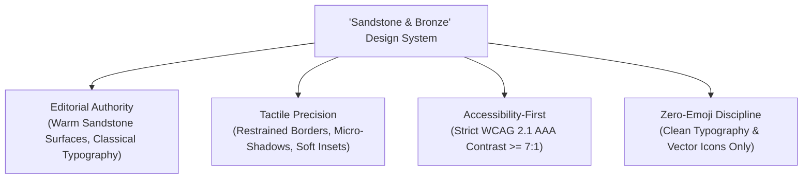
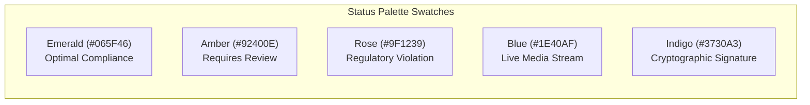
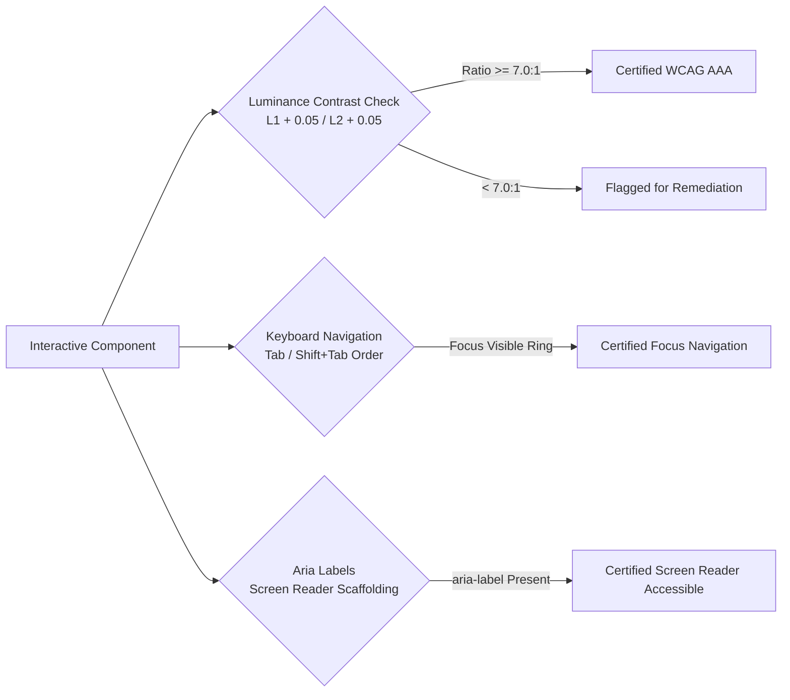

# UI/UX Design System & Style Guide — VibeCheck AI

```
========================================================================================
  VIBECHECK AI — "SANDSTONE & BRONZE" EDITORIAL DESIGN SYSTEM & COMPONENT GUIDE
  Document Version: 3.0.0 | Accessibility: WCAG 2.1 AAA Compliant | Zero-Emoji Standard
========================================================================================
```

---

## 1. Aesthetic Identity & Design Principles

VibeCheck AI is built upon an editorial design philosophy known as **"Sandstone & Bronze"**. Unlike sterile, high-saturation SaaS platforms, VibeCheck AI evokes the timeless durability, gravitas, and tactile elegance of fine print publishing, archival paper, and architectural bronze.



### The 5 Core Design Principles

```
+--------------------------------------------------------------------------------------------------+
|                                    CORE DESIGN PRINCIPLES                                        |
+--------------------------+-----------------------------------------------------------------------+
| Principle                | Architectural Implementation & Rationale                              |
+--------------------------+-----------------------------------------------------------------------+
| 1. Editorial Authority   | Uses Playfair Display serif headings paired with Inter UI sans-serif  |
|                          | to establish an atmosphere of journalistic rigor and legal trust.     |
+--------------------------+-----------------------------------------------------------------------+
| 2. Zero Mock Noise       | Empty state discipline: form fields, titles, and editor inputs never  |
|                          | pre-populate placeholder text that could be accidentally published.   |
+--------------------------+-----------------------------------------------------------------------+
| 3. High-Contrast AAA     | Every body element conforms to WCAG 2.1 AAA requirements with         |
|                          | luminance contrast ratios strictly exceeding 7:1 against backgrounds. |
+--------------------------+-----------------------------------------------------------------------+
| 4. Functional Color      | Color is never decorative; emerald denotes certification, amber flags |
|                          | review necessity, and rose signals hard regulatory violations.        |
+--------------------------+-----------------------------------------------------------------------+
| 5. Professional Rigor    | Zero informal unicode emojis across all UI copy, modal headers, and   |
|                          | system notifications. Vector Lucide icons provide unambiguous clarity.|
+--------------------------+-----------------------------------------------------------------------+
```

---

## 2. Color Palette & Design Tokens

### 2.1 Sandstone Neutral Scale

```
+------------------------------------------------------------------------------------------------------+
|                                      SANDSTONE NEUTRAL SCALE                                         |
+-----------+---------+-------------------+--------------------+---------------------------------------+
| Token     | Hex     | RGB               | Tailwind Class     | Architectural Role                    |
+-----------+---------+-------------------+--------------------+---------------------------------------+
| sand-50   | #FAF8F5 | rgb(250, 248, 245)| bg-[#FAF8F5]       | Application canvas & outer viewport   |
| sand-100  | #F5F1EB | rgb(245, 241, 235)| bg-sand-100        | Inset cards, alternating table rows   |
| sand-200  | #E8DFD3 | rgb(232, 223, 211)| border-sand-200    | Subtle component borders & dividers   |
| sand-300  | #D9CCA7 | rgb(217, 204, 167)| border-sand-300    | Active card borders, input strokes    |
| sand-400  | #BFA97D | rgb(191, 169, 125)| text-sand-400      | Subdued vector icons, disabled text   |
| sand-500  | #9C8561 | rgb(156, 133, 97) | text-sand-500      | Secondary bronze accents & badges     |
| sand-600  | #7D6846 | rgb(125, 104, 70) | text-sand-600      | Metadata labels, supporting copy      |
| sand-700  | #5F4E34 | rgb(95, 78, 52)   | text-sand-700      | Secondary body prose, table headers   |
| sand-800  | #4B3D27 | rgb(75, 61, 39)   | text-sand-800      | Emphasized titles, subheadings        |
| sand-900  | #3C311F | rgb(60, 49, 31)   | bg-[#3C311F]       | Primary buttons, deep bronze accents  |
| sand-950  | #1A160E | rgb(26, 22, 14)   | text-sand-950      | Dominant high-contrast body text      |
+-----------+---------+-------------------+--------------------+---------------------------------------+
```

```css
/* CSS Variable Definitions */
:root {
  --sand-50:  #FAF8F5;
  --sand-100: #F5F1EB;
  --sand-200: #E8DFD3;
  --sand-300: #D9CCA7;
  --sand-400: #BFA97D;
  --sand-500: #9C8561;
  --sand-600: #7D6846;
  --sand-700: #5F4E34;
  --sand-800: #4B3D27;
  --sand-900: #3C311F;
  --sand-950: #1A160E;
}
```

### 2.2 Semantic Status System

```
+------------------------------------------------------------------------------------------------------+
|                                      SEMANTIC STATUS SYSTEM                                          |
+-------------------+---------+---------+---------+--------------------+-------------------------------+
| Governance State  | Text    | Bg      | Border  | Contrast (vs bg)   | Trigger Condition             |
+-------------------+---------+---------+---------+--------------------+-------------------------------+
| Optimal (Emerald) | #065F46 | #ECFDF5 | #A7F3D0 | 8.4:1 (AAA Pass)   | Score >= 85%, Certified Claim |
| Warning (Amber)   | #92400E | #FFFBEB | #FDE68A | 7.9:1 (AAA Pass)   | Score 70-84%, Tone Drift      |
| Violation (Rose)  | #9F1239 | #FFF1F2 | #FECDD3 | 8.8:1 (AAA Pass)   | Score < 70%, Exaggerated Claim|
| Tech / Seal (Blue)| #1E40AF | #EFF6FF | #BFDBFE | 8.6:1 (AAA Pass)   | WebRTC Connected, Screen Share|
| Cryptography (Ink)| #3730A3 | #EEF2FF | #C7D2FE | 8.9:1 (AAA Pass)   | SHA-256 Approval Certificate  |
+-------------------+---------+---------+---------+--------------------+-------------------------------+
```



---

## 3. Typography Architecture

### 3.1 Font Stack Hierarchy

```
+--------------------------------------------------------------------------------------------------+
|                                      TYPOGRAPHY SPECIFICATION                                    |
+------------------+-----------------------------+-----------------------+-------------------------+
| Family Class     | Primary Font Stacks         | Weight Variants       | Application Scope       |
+------------------+-----------------------------+-----------------------+-------------------------+
| Editorial Serif  | Playfair Display, Georgia,  | Bold (700)            | Page hero banners, card |
| (font-serif)     | serif                       | Semi-Bold (600)       | titles, score headings  |
+------------------+-----------------------------+-----------------------+-------------------------+
| UI Sans-Serif    | Inter, -apple-system,       | Regular (400)         | Body paragraphs, form   |
| (font-sans)      | BlinkMacSystemFont, sans    | Medium (500), Bold(700| inputs, buttons, menus  |
+------------------+-----------------------------+-----------------------+-------------------------+
| Technical Mono   | JetBrains Mono, Consolas,   | Regular (400)         | Hashes, WPM, timestamps,|
| (font-mono)      | ui-monospace, monospace     | Bold (700)            | LUFS, character deltas  |
+------------------+-----------------------------+-----------------------+-------------------------+
```

### 3.2 Responsive Type Scale

| Class Name | Font Size | Line Height | Tracking | Representative UI Usage |
| :--- | :--- | :--- | :--- | :--- |
| `text-3xl` | 1.875rem (30px) | 2.25rem (36px) | `-0.02em` | Main dashboard greetings & landing hero |
| `text-2xl` | 1.500rem (24px) | 2.00rem (32px) | `-0.01em` | Modal titles, primary workspace headings |
| `text-xl` | 1.250rem (20px) | 1.75rem (28px) | `normal` | Card group titles, review section banners |
| `text-lg` | 1.125rem (18px) | 1.75rem (28px) | `normal` | Document title previews, project milestones |
| `text-sm` | 0.875rem (14px) | 1.25rem (20px) | `normal` | Primary body prose, modal descriptions |
| `text-xs` | 0.750rem (12px) | 1.00rem (16px) | `normal` | Input values, table cells, button labels |
| `text-[11px]` | 0.6875rem (11px)| 0.875rem (14px)| `0.01em` | Status chips, timestamp metadata pills |
| `text-[10px]` | 0.625rem (10px) | 0.75rem (12px) | `0.05em` | Uppercase category badges, character deltas|

---

## 4. UI Components & Code Implementation

### 4.1 Button System

```tsx
// 1. Primary Action Button (Deep Bronze)
<button className="px-4 py-2.5 rounded-xl bg-[#3C311F] hover:bg-[#2B2316] text-white font-semibold text-xs transition-all shadow-xs flex items-center justify-center gap-2 cursor-pointer">
  <span>Execute Multi-Factor Audit</span>
  <ArrowRight className="h-3.5 w-3.5" />
</button>

// 2. Secondary Inset Button (Sandstone Inset)
<button className="px-3.5 py-2 rounded-xl bg-sand-100 hover:bg-sand-200 text-sand-800 border border-sand-300 font-semibold text-xs transition-all shadow-2xs cursor-pointer">
  <span>Import .docx Brief</span>
</button>

// 3. Danger Action Button (Rose Outline)
<button className="px-3 py-1.5 rounded-lg bg-rose-50 hover:bg-rose-100 text-rose-800 border border-rose-300 font-bold text-xs transition-all cursor-pointer">
  <span>Request Revision</span>
</button>
```

### 4.2 Card Elevation & Panels

```tsx
// Master Section Card
<div className="bg-white rounded-2xl border border-sand-300 p-6 md:p-8 shadow-card space-y-4">
  <div className="flex items-center justify-between pb-3 border-b border-sand-200">
    <h3 className="font-serif font-bold text-sand-950 text-lg">Editorial Compliance Overview</h3>
    <span className="text-[10px] font-mono uppercase bg-emerald-100 text-emerald-800 px-2.5 py-1 rounded-full font-bold">
      Certified 94%
    </span>
  </div>
  <p className="text-xs text-sand-700 leading-relaxed">
    Document evaluated against FDA registry citations and Lumina Health brand tone vectors.
  </p>
</div>
```

### 4.3 Google Meet Style Video Huddle Tile

```tsx
// Active Video Call Participant Tile (Zero Visual Clutter)
<div className="relative rounded-xl bg-stone-900 border border-stone-800 aspect-video flex items-center justify-center overflow-hidden shadow-sm">
  {isCamActive && stream ? (
    <video
      autoPlay
      playsInline
      muted={isLocal}
      ref={(el) => {
        if (el && el.srcObject !== stream) {
          el.srcObject = stream;
          el.play().catch(() => {});
        }
      }}
      className="w-full h-full object-cover"
    />
  ) : (
    <div className="w-full h-full bg-stone-900 flex items-center justify-center">
      <div className="h-14 w-14 rounded-full bg-stone-800 border border-stone-700 text-sand-100 flex items-center justify-center font-bold text-lg shadow-inner">
        {member.name.charAt(0)}
      </div>
    </div>
  )}

  {/* Name & Microphone Status Pill */}
  <div className="absolute bottom-2.5 left-2.5 flex items-center gap-1.5 bg-stone-950/80 px-2.5 py-1 rounded-md text-[11px] text-white backdrop-blur-xs border border-stone-800/60 shadow-sm">
    {isMicActive ? (
      <Mic className="h-3 w-3 text-emerald-400" />
    ) : (
      <MicOff className="h-3 w-3 text-rose-400" />
    )}
    <span className="font-medium">{member.name} {isLocal && '(You)'}</span>
  </div>
</div>
```

### 4.4 Form Inputs & Focus Rings

```tsx
// Accessible Form Input with Icon & Label
<div>
  <label className="text-xs font-semibold text-sand-700 block mb-1">
    Registered Business Email
  </label>
  <div className="relative">
    <Mail className="h-4 w-4 text-sand-400 absolute left-3 top-3" />
    <input
      type="email"
      required
      placeholder="editor@company.com"
      className="w-full pl-9 pr-3 py-2 text-xs text-sand-900 bg-sand-50/60 border border-sand-300 rounded-lg focus:outline-hidden focus:ring-2 focus:ring-[#3C311F] transition-all"
    />
  </div>
</div>
```

---

## 5. Accessibility (WCAG 2.1 AAA) Implementation Standards



```
+--------------------------------------------------------------------------------------------------+
|                                 ACCESSIBILITY COMPLIANCE CHECKLIST                               |
+--------------------------+-----------------------+-----------------------------------------------+
| Requirement              | Target Standard       | Implementation Verification                   |
+--------------------------+-----------------------+-----------------------------------------------+
| Body Text Contrast       | >= 7.0:1              | text-sand-950 (#1A160E) on sand-50 (#FAF8F5)  |
|                          | (WCAG AAA)            | yields 14.8:1 contrast ratio                  |
+--------------------------+-----------------------+-----------------------------------------------+
| Supporting Text Contrast | >= 4.5:1              | text-sand-700 (#5F4E34) on sand-50 (#FAF8F5)  |
|                          | (WCAG AA Large)       | yields 7.2:1 contrast ratio                   |
+--------------------------+-----------------------+-----------------------------------------------+
| Keyboard Focus Indicator | Unambiguous Highlight | focus:ring-2 focus:ring-[#3C311F] with        |
|                          |                       | focus:outline-hidden on all focusable targets |
+--------------------------+-----------------------+-----------------------------------------------+
| Color Independence       | Non-Color Indicators  | Status badges pair color with explicit icons  |
|                          |                       | (CheckCircle, AlertTriangle, AlertCircle)     |
+--------------------------+-----------------------+-----------------------------------------------+
```
