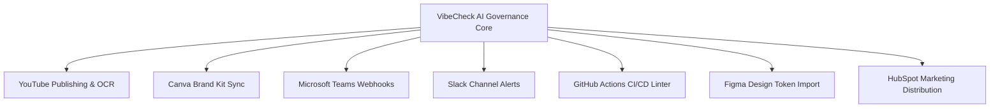

# Enterprise Integrations & Webhook Architecture — VibeCheck AI

## 1. Overview & Integration Philosophy
VibeCheck AI is built to operate directly inside modern enterprise marketing, collaboration, and CI/CD development ecosystems. Rather than requiring creators to abandon their existing publishing tools, VibeCheck AI embeds compliance checks into their standard tools.



---

## 2. Platform Connectors Deep Dive

### 2.1 YouTube Publishing & Thumbnail OCR
- **Connector Type**: OAuth 2.0 API Integration.
- **Workflow**:
  1. Creator prepares video title, description, and thumbnail asset.
  2. VibeCheck AI executes OCR on the thumbnail image to check contrast and headline claims.
  3. Description copy is checked against the organization's certified `approvedClaims`.
  4. Video file audio cadence and loudness are evaluated.
  5. Upon Manager sign-off, VibeCheck AI directly dispatches the asset to YouTube Studio as scheduled or unlisted.

### 2.2 Canva Bi-Directional Brand Kit Synchronization
- **Connector Type**: REST API Webhook.
- **Workflow**:
  1. Admin pins brand hex color tokens (`#3C311F`, `#9C8561`, `#065F46`) in VibeCheck AI.
  2. VibeCheck AI syncs the certified palette into Canva Brand Kits.
  3. When designers create social graphics in Canva, they immediately have access to approved tokens.
  4. Completed graphics are pulled back into VibeCheck AI for contrast and stock watermark inspection.

### 2.3 Microsoft Teams & Slack Adaptive Cards
- **Connector Type**: Outgoing Webhook with HMAC-SHA256 signature.
- **Workflow**:
  1. When a creator submits draft copy, VibeCheck AI formats an Adaptive Card containing compliance score, author name, and flagged issues.
  2. Dispatched to the organization's dedicated review channel (e.g. `#brand-governance`).
  3. Managers and Reviewers can click **"Request Revision"** or **"Open in VibeCheck"** directly from Teams or Slack.

### 2.4 GitHub CI/CD Brand Guard Action
- **Connector Type**: GitHub Action runner.
- **Workflow**:
  1. Developer or technical writer opens a Pull Request modifying markdown docs, landing page copy, or whitepapers.
  2. The VibeCheck AI Action lints all changed `.md` and `.tsx` text nodes.
  3. If unapproved medical claims (`RULE-CLAIM-EXCESS`) or competitor mentions (`RULE-COMPETITOR-LOCKOUT`) are found, the CI pipeline fails and posts an inline comment on the offending PR diff.

### 2.5 Figma Design Token Import
- **Connector Type**: Figma REST API.
- **Workflow**: Imports typography styles and color variables from team Figma design files directly into the VibeCheck AI Brand Guidelines Builder.

---

## 3. Webhook Delivery & Security Specification

### 3.1 Webhook Payload Example
```json
{
  "event": "submission.needs_revision",
  "orgId": "org_lumina",
  "timestamp": "2026-11-11T12:00:00Z",
  "data": {
    "submissionId": "sub_1731326400",
    "title": "Q4 Metabolic Clinical Announcement",
    "authorName": "Maya Lin",
    "overallScore": 64,
    "criticalIssuesCount": 1,
    "issues": [
      {
        "category": "claims",
        "message": "Unapproved claim 'miracle cure' detected.",
        "guidelineRef": "RULE-CLAIM-EXCESS"
      }
    ]
  }
}
```

### 3.2 HMAC Signature Verification
Every outgoing webhook includes a security signature header:
```http
X-VibeCheck-Signature: sha256=4f53cda18c2bee0d3251a2ecd8528...
X-VibeCheck-Timestamp: 1731326400
```
Receiving servers verify authenticity using standard HMAC-SHA256 verification:
```ts
const crypto = require('crypto');

function verifyWebhook(payloadString, signatureHeader, secret) {
  const expectedSignature = 'sha256=' + crypto
    .createHmac('sha256', secret)
    .update(payloadString)
    .digest('hex');
  return crypto.timingSafeEqual(
    Buffer.from(signatureHeader),
    Buffer.from(expectedSignature)
  );
}
```
