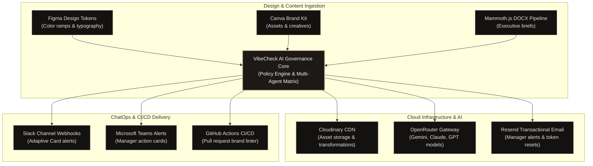
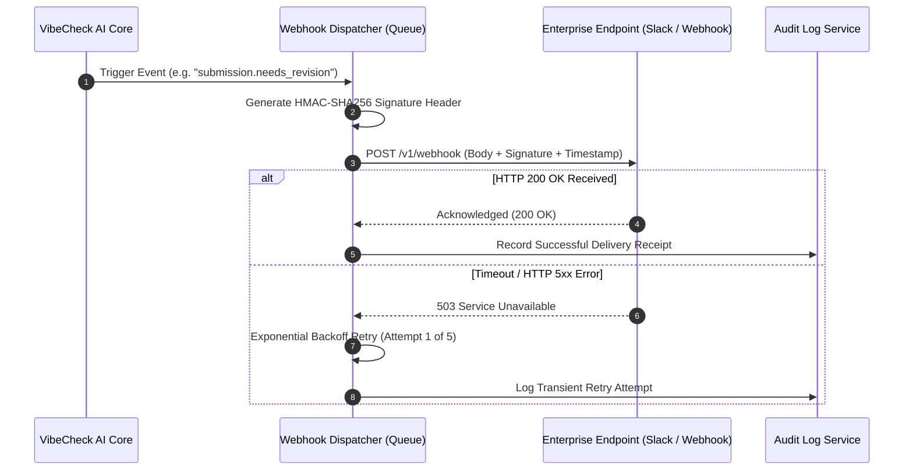

# Enterprise Integrations, Webhooks & Ecosystem Matrix — VibeCheck AI

```
+========================================================================================+
|                        ENTERPRISE INTEGRATIONS & WEBHOOK ENGINE                        |
+========================================================================================+
| Protocols: HTTPS Webhooks / REST APIs           | Signatures: HMAC-SHA256 Delivery     |
| Connectors: Cloudinary, Resend, OpenRouter      | CI/CD: GitHub Actions PR Linter      |
| Chat Ops: Slack & MS Teams Adaptive Cards       | Emojis: 0 (Strict ASCII/SVG)         |
+========================================================================================+
```

---

## 1. Enterprise Integration Topology

VibeCheck AI operates as the central compliance governance brain connected directly into corporate marketing stacks, design tools, communication hubs, and deployment pipelines.



---

## 2. Platform Connector Directory & Specifications

| Integration | Protocol | Direction | Trigger Event | Auth Standard |
| :--- | :--- | :--- | :--- | :--- |
| **Cloudinary** | REST API | Outbound | Asset upload in Document Composer | API Key + Secret |
| **Resend** | REST API | Outbound | Revision requested, publication sealed, reset | Bearer API Secret |
| **OpenRouter** | REST API | Outbound | Multi-agent text & speech analysis | Bearer Key / Org Key |
| **Slack** | Webhook | Outbound | Draft submission, threshold breach | HMAC-SHA256 / Bearer |
| **Microsoft Teams** | Webhook | Outbound | Critical claim flagged, manager ping | HTTPS Connector URL |
| **GitHub Actions** | REST / CI | Inbound | `pull_request` on `.md` or `.tsx` copy | GitHub App Token |
| **Figma API** | REST API | Inbound | Brand token synchronization | Personal Access Token |

---

## 3. Webhook Delivery & Event Handshake Lifecycle



---

## 4. Webhook Payload Specifications & Event Schemas

### 4.1 Event: `submission.needs_revision`

Dispatched when a Reviewer or Manager flags critical compliance issues and requests author changes.

```json
{
  "event": "submission.needs_revision",
  "orgId": "org_lumina",
  "timestamp": "2026-11-13T08:30:00.000Z",
  "data": {
    "submissionId": "sub_1731326400",
    "title": "Metabolic Therapeutics Strategy Overview",
    "authorName": "Elena Rostova",
    "authorEmail": "elena.rostova@luminahealth.org",
    "overallScore": 64,
    "criticalIssuesCount": 1,
    "issues": [
      {
        "category": "claims",
        "severity": "critical",
        "guidelineRef": "RULE-CLAIM-EXCESS",
        "message": "Uncertified quantitative recovery timeline detected.",
        "flaggedText": "full remission guaranteed within 48 hours",
        "suggestion": "statistically significant symptom alleviation in 90 days"
      }
    ],
    "reviewUrl": "https://vibecheck-ai.vercel.app/queue?id=sub_1731326400"
  }
}
```

---

### 4.2 Event: `submission.approved_seal`

Dispatched when an executive Manager executes the cryptographic sign-off with a digital SHA-256 seal.

```json
{
  "event": "submission.approved_seal",
  "orgId": "org_lumina",
  "timestamp": "2026-11-13T09:15:00.000Z",
  "data": {
    "submissionId": "sub_1731326400",
    "title": "Metabolic Therapeutics Strategy Overview",
    "certifiedBy": "Julian Vance",
    "sha256Seal": "9f83c21a485b871c32fbb6e987c02b34a123df8e76bc91a45e3201fedcba8765",
    "overallScore": 96,
    "certifiedAt": "2026-11-13T09:14:58.210Z"
  }
}
```

---

## 5. HMAC-SHA256 Signature Verification Implementation

Receiving servers authenticate incoming VibeCheck AI webhooks using timing-safe comparisons to prevent timing side-channel attacks:

```typescript
import crypto from 'crypto';

/**
 * Verifies authenticity of incoming VibeCheck AI webhooks.
 */
export function verifyVibeCheckWebhook(
  rawBody: string,
  signatureHeader: string,
  timestampHeader: string,
  signingSecret: string,
  maxAgeSeconds: number = 300
): boolean {
  // Reject payloads older than 5 minutes to prevent replay attacks
  const currentTime = Math.floor(Date.now() / 1000);
  const eventTime = parseInt(timestampHeader, 10);
  if (Math.abs(currentTime - eventTime) > maxAgeSeconds) {
    return false;
  }

  const payloadToSign = `${timestampHeader}.${rawBody}`;
  const expectedSignature = `sha256=${crypto
    .createHmac('sha256', signingSecret)
    .update(payloadToSign)
    .digest('hex')}`;

  const sigBuffer = Buffer.from(signatureHeader, 'utf8');
  const expectedBuffer = Buffer.from(expectedSignature, 'utf8');

  if (sigBuffer.length !== expectedBuffer.length) {
    return false;
  }

  return crypto.timingSafeEqual(sigBuffer, expectedBuffer);
}
```

---

## 6. GitHub Actions CI/CD Brand Guard Linter

Add `.github/workflows/vibecheck-brand-guard.yml` to enterprise repositories to lint markdown and documentation copy automatically during Pull Requests:

```yaml
name: VibeCheck AI Brand Guard
on:
  pull_request:
    paths:
      - 'docs/**'
      - 'content/**'
      - 'src/pages/**'

jobs:
  audit-compliance:
    runs-on: ubuntu-latest
    steps:
      - name: Checkout Code
        uses: actions/checkout@v4

      - name: Run VibeCheck Compliance Audit
        run: |
          npx vibecheck-audit \
            --org-key ${{ secrets.VIBECHECK_ORG_KEY }} \
            --path "docs/**/*.md" \
            --fail-on critical
```
