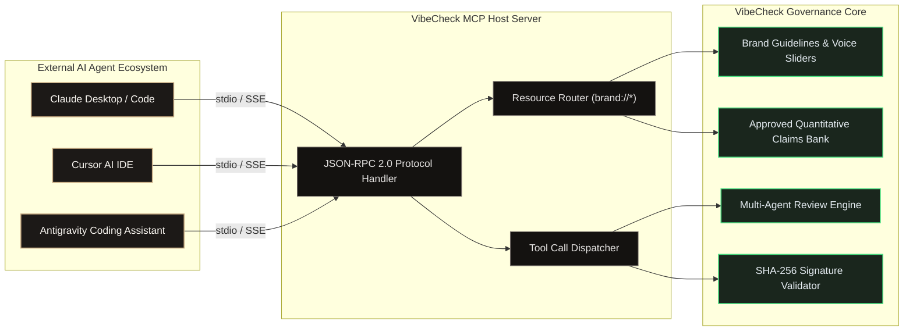
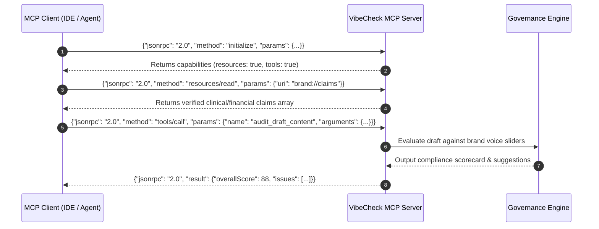

# Model Context Protocol (MCP) Server Architecture — VibeCheck AI

```
+========================================================================================+
|                        MODEL CONTEXT PROTOCOL (MCP) INTERFACE                          |
+========================================================================================+
| Protocol: Model Context Protocol (JSON-RPC 2.0) | Transports: stdio pipe / HTTP + SSE  |
| Target Clients: Claude Code, Cursor, Antigravity| Auth: Org Key Partitioning           |
| Governance Roles: Resources, Tools, Prompts     | Emojis: 0 (Strict ASCII/SVG)         |
+========================================================================================+
```

---

## 1. MCP Architectural Philosophy

The **Model Context Protocol (MCP)** establishes an open standard enabling external AI agents, autonomous marketing bots, and developer IDEs to securely interface with VibeCheck AI as an authoritative compliance oracle.



---

## 2. MCP Handshake & Protocol Lifecycle



---

## 3. Supported MCP Resources

External agents can read organizational guidelines, verified claims, and historical error attributions as standard MCP resources:

### 3.1 Resource: `brand://guidelines`
- **URI**: `brand://guidelines`
- **MIME Type**: `application/json`
- **Purpose**: Exposes active voice parameters, tone sliders, and prohibited terms.

```json
{
  "brandName": "Lumina Health",
  "toneParameters": {
    "formality": 80,
    "seriousness": 85,
    "boldness": 60
  },
  "colorPalette": {
    "primary": "#3C311F",
    "secondary": "#9C8561",
    "accent": "#065F46"
  },
  "prohibitedTerms": ["miracle cure", "cheap", "100% guaranteed"],
  "competitorLockouts": ["OmniCare Health", "OmniCare"]
}
```

---

### 3.2 Resource: `brand://claims`
- **URI**: `brand://claims`
- **MIME Type**: `application/json`
- **Purpose**: Authoritative whitelist of certified metrics, recovery timelines, and citations.

```json
[
  {
    "id": "cl_001",
    "claim": "Demonstrated 34% reduction in acute symptom flares within 90 days.",
    "citation": "New England Journal of Medicine, Nov 2024",
    "scope": "Metabolic and cardiovascular cohorts only"
  }
]
```

---

## 4. Supported MCP Tool Definitions

External LLM agents can trigger deterministic compliance checks via MCP tool calling:

### 4.1 Tool: `audit_draft_content`

```json
{
  "name": "audit_draft_content",
  "description": "Evaluates draft text against enterprise brand guidelines, claims database, and competitor lockouts.",
  "inputSchema": {
    "type": "object",
    "properties": {
      "content": {
        "type": "string",
        "description": "The raw editorial copy to inspect."
      },
      "format": {
        "type": "string",
        "enum": ["ad_copy", "social_media", "whitepaper", "executive_brief"],
        "description": "Publication format target."
      },
      "channel": {
        "type": "string",
        "description": "Target syndication channel (e.g. LinkedIn, Press Release)."
      }
    },
    "required": ["content"]
  }
}
```

#### Tool Response Example
```json
{
  "overallScore": 92,
  "summary": "Draft adheres closely to corporate voice standards. Minor syntax recommendation.",
  "issues": [
    {
      "id": "iss_mcp_01",
      "category": "grammar",
      "severity": "minor",
      "message": "Subject-verb number agreement mismatch in second paragraph.",
      "flaggedText": "The clinical team are preparing",
      "suggestion": "The clinical team is preparing"
    }
  ],
  "rewrittenText": "The clinical team is preparing the upcoming phase III study..."
}
```

---

### 4.2 Tool: `verify_cryptographic_signature`

```json
{
  "name": "verify_cryptographic_signature",
  "description": "Verifies whether a published document's SHA-256 seal matches the verified tamper-evident audit record.",
  "inputSchema": {
    "type": "object",
    "properties": {
      "submissionId": { "type": "string" },
      "content": { "type": "string" },
      "signature": { "type": "string" }
    },
    "required": ["submissionId", "content", "signature"]
  }
}
```

---

## 5. Client Configuration Guide

### 5.1 Claude Desktop Configuration (`claude_desktop_config.json`)

```json
{
  "mcpServers": {
    "vibecheck-governance": {
      "command": "node",
      "args": ["/usr/local/bin/vibecheck-mcp-server"],
      "env": {
        "OPENROUTER_API_KEY": "sk-or-v1-xxxxxxxxxxxx",
        "VIBECHECK_ORG_KEY": "LUMINA-7821-HEALTH"
      }
    }
  }
}
```

### 5.2 Cursor IDE Integration (`.cursor/mcp.json`)

```json
{
  "mcpServers": {
    "vibecheck": {
      "type": "stdio",
      "command": "node",
      "args": ["./scripts/mcp-server.js"],
      "env": {
        "VIBECHECK_ORG_KEY": "${env:VIBECHECK_ORG_KEY}"
      }
    }
  }
}
```

---

## 6. MCP Protocol Security & Sandboxing Matrix

```
+---------------------------------------------------------------------------------------+
| MCP SECURITY BOUNDARY SPECIFICATION                                                   |
+---------------------------------------------------------------------------------------+
| Transport Isolation  | stdio pipes run in child process sandbox with no socket listen  |
| Tenancy Partitioning | Every MCP call scoped to tenant VIBECHECK_ORG_KEY               |
| Rate Limiting        | Max 60 tool calls per minute per client instance               |
| Content Integrity    | SHA-256 verifiable signatures prevent external tampering        |
+---------------------------------------------------------------------------------------+
```
