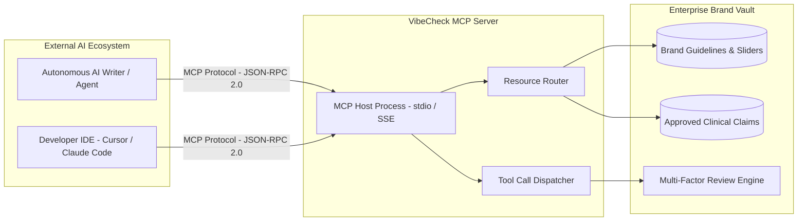

# Model Context Protocol (MCP) Integration Specification — VibeCheck AI

## 1. Overview & Purpose
The **Model Context Protocol (MCP)** standardizes how external AI coding agents, autonomous marketing bots, and IDE tools securely retrieve brand guidelines, verify claims, and request compliance scores from VibeCheck AI.

By implementing MCP, VibeCheck AI acts as an authoritative enterprise compliance context provider for any client supporting the MCP standard (Claude Code, Cursor, Antigravity, custom agent runners).

---

## 2. MCP Server Architecture



---

## 3. Supported MCP Resources

External agents can read organizational guidelines and claim repositories as standardized MCP resources:

### 3.1 `brand://guidelines`
- **URI**: `brand://guidelines`
- **MIME Type**: `application/json`
- **Description**: Returns the active organization's tone parameters, prohibited vocabulary, color tokens, and competitor lockouts.
- **Example Content**:
  ```json
  {
    "brandName": "Lumina Health",
    "toneParameters": { "formality": 75, "seriousness": 80, "boldness": 60 },
    "colorTokens": { "primary": "#3C311F", "secondary": "#9C8561" },
    "prohibitedTerms": ["miracle cure", "cheap", "100% guaranteed"],
    "competitorLockouts": ["OmniCare Health"]
  }
  ```

### 3.2 `brand://claims`
- **URI**: `brand://claims`
- **MIME Type**: `application/json`
- **Description**: Exposes certified quantitative performance benchmarks, clinical trial citations, and allowable metrics.
- **Example Content**:
  ```json
  [
    {
      "id": "cl_1",
      "claim": "34% reduction in acute symptom flares within 90 days.",
      "citation": "New England Journal of Medicine, Nov 2024",
      "context": "For metabolic health programs only."
    }
  ]
  ```

---

## 4. Supported MCP Tools

External agents can execute real-time compliance audits before publishing or generating copy:

### 4.1 Tool: `audit_draft_content`
- **Description**: Scans text drafts against brand guidelines, tone parameters, and approved claims.
- **Input Schema**:
  ```json
  {
    "type": "object",
    "properties": {
      "content": {
        "type": "string",
        "description": "The draft text content to evaluate"
      },
      "format": {
        "type": "string",
        "enum": ["ad_copy", "social_media", "whitepaper", "press_release"],
        "description": "Content publication format"
      },
      "channel": {
        "type": "string",
        "description": "Target publishing channel (e.g. LinkedIn, Blog)"
      }
    },
    "required": ["content"]
  }
  ```
- **Returns**: Overall compliance score (0–100), list of violation flags, and an intent-preserving compliant rewrite.

### 4.2 Tool: `verify_cryptographic_signature`
- **Description**: Verifies whether an asset's SHA-256 signature matches the approved text in the immutable audit log.
- **Input Schema**:
  ```json
  {
    "type": "object",
    "properties": {
      "submissionId": { "type": "string" },
      "content": { "type": "string" },
      "signature": { "type": "string" }
    },
    "required": ["submissionId", "content", "signature"]
  }
  ```
- **Returns**: Boolean validity, signer identity, and verification timestamp.

---

## 5. Client Configuration File (`mcp_config.json`)

To register VibeCheck AI as an MCP server in your local AI agent setup:

```json
{
  "mcpServers": {
    "vibecheck-governance": {
      "command": "node",
      "args": ["dist/mcp-server.js"],
      "env": {
        "OPENROUTER_API_KEY": "sk-or-v1-...",
        "VIBECHECK_ORG_KEY": "LUMINA-7821-HEALTH"
      }
    }
  }
}
```
