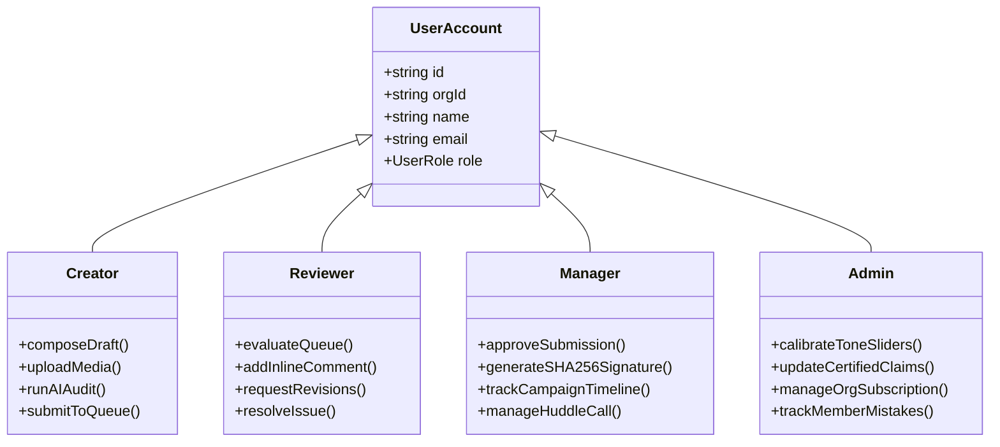

# Product Requirements Document (PRD) — VibeCheck AI

## Document Control
- **Document Version**: 2.4.0
- **Status**: Approved & Production Ready
- **Target Audience**: Product Managers, Engineering Leads, Frontend/Backend Developers, Compliance Officers

---

## 1. Executive Summary & Vision

**VibeCheck AI** is an enterprise-grade, multi-modal brand governance and content compliance platform. It bridges the gap between high-speed creative workflows and strict regulatory, editorial, and legal requirements.

Traditional enterprise content distribution suffers from costly post-publication retractions, brand guideline drift, unverified medical/financial claims, and disjointed team communication. VibeCheck AI introduces automated, multi-factor pre-publication guardrails across **text**, **images**, **audio**, and **video**, backed by an ensemble of Large Language Models (LLMs), Computer Vision (CV), WebRTC collaboration huddles, and SHA-256 cryptographic sign-offs.

---

## 2. Core Problem Statement

### 2.1 The Crisis of Unchecked Enterprise Publishing
1. **Unverified Claims & Regulatory Liabilities**: Marketing copywriters and agencies frequently cite exaggerated performance metrics (e.g., *"100% cure"*, *"guaranteed 10x ROI"*), triggering regulatory fines and brand damage.
2. **Visual & Accessibility Inconsistencies**: Graphic creatives are produced with substandard WCAG contrast, unapproved color palette drift, and unauthorized stock imagery containing commercial watermarks.
3. **Auditory & Speech Misalignment**: Podcasts, keynote recordings, and video voiceovers suffer from erratic cadence, excessive filler words, unnormalized audio loudness, and unlicensed music.
4. **Fragmented Review Cycles**: Revisions happen across email threads, Google Docs, and Slack, obscuring author accountability and audit trails.
5. **Absence of Tamper-Proof Auditability**: Regulated industries (healthcare, finance, enterprise SaaS) require non-repudiation proof of *what* was approved, *when*, and *by whom*.

---

## 3. Product Goals & Target Success Metrics (KPIs)

| Objective | Target KPI | Baseline | Measurement Method |
| :--- | :--- | :--- | :--- |
| **Brand Guideline Drift** | $< 1.5\%$ across all published assets | $18.4\%$ | Automated guideline scoring engine |
| **Review & Sign-Off Cycle Time** | Reduce turnaround by $\ge 65\%$ | 4.2 business days | Lifecycle timestamp delta (`created` to `approved`) |
| **Unapproved Claim Interceptions** | $100\%$ interception pre-publication | $82\%$ | Hard-blocking rule `RULE-CLAIM-EXCESS` |
| **Accessibility Compliance (WCAG AAA)**| $100\%$ of images & video text | $54\%$ | Canvas luminance contrast calculation |
| **Team Onboarding Time** | $< 2$ minutes per seat | 45 minutes | Frictionless company admin key onboarding |

---

## 4. User Personas & Permissions Matrix

### 4.1 Creator Persona (Maya)
- **Role Description**: Content creator, copywriter, or agency specialist.
- **Jobs to be Done**: Draft copy in a clean editor, import DOCX files, execute real-time AI compliance audits, and submit approved drafts to the approval queue.
- **Frustrations**: Receiving vague reviewer feedback days after drafting; unclear claim boundaries.

### 4.2 Reviewer Persona (Julian)
- **Role Description**: Editorial specialist or legal compliance officer.
- **Jobs to be Done**: Filter queue submissions by compliance score, evaluate flagged claim boundaries, request author revisions, and resolve inline annotations.
- **Frustrations**: Sifting through lengthy documents manually to verify citations against internal medical/scientific claim databases.

### 4.3 Manager Persona (Elena)
- **Role Description**: Head of Brand, Creative Director, or Marketing VP.
- **Jobs to be Done**: Supervise campaign milestones, conduct live team review huddles, and grant final publication release with SHA-256 cryptographic sign-offs.
- **Frustrations**: Inability to prove exact content state when publication issues arise.

### 4.4 Admin Persona (Alex)
- **Role Description**: Organization Owner / Chief Compliance Officer.
- **Jobs to be Done**: Calibrate tone sliders, pin brand color tokens, configure certified claims and glossary lockouts, manage the ₹5,000/mo company subscription, and inspect the Member Mistakes & Accuracy Meter.

---

## 5. Functional Requirements Deep Dive

### 5.1 Multi-Factor Content Review Engine
- **FR-1.1 Grammar & Linguistic Polishing**: Automated grammatical parsing identifying tense mismatches, irregular verbs (*"decides to went"*, *"buyed"*), and subject-verb disagreements.
- **FR-1.2 Tone Calibration**: Real-time alignment against Formality (0–100), Seriousness (0–100), and Boldness (0–100) sliders.
- **FR-1.3 Certified Claims Enforcement**: Every factual statement is matched against the organization's approved claim library. Unsupported or exaggerated statements trigger `RULE-CLAIM-EXCESS`.
- **FR-1.4 Competitor & Terminology Lockout**: Enforces organizational glossary (*e.g., "Member" instead of "Customer"*) and locks out rival competitor citations.
- **FR-1.5 DOCX Client Extraction**: Instant conversion of `.docx` documents into markdown formatted text using Mammoth.js.

### 5.2 Multi-Modal Media Governance
- **FR-2.1 Color Palette & Delta-E Matching**: Canvas pixel extraction sampling dominant hues and comparing Euclidean distance against brand color tokens.
- **FR-2.2 WCAG 2.1 AAA Contrast Inspection**: Foreground-to-background luminance contrast verification ($> 7:1$ for AAA compliance).
- **FR-2.3 Stock Watermark Detection**: Scan image and video frames for watermarks from Getty Images, Shutterstock, iStock, Adobe Stock, and Alamy.
- **FR-2.4 OpenRouter Audio Transcription**: Verbatim speech transcription powered by OpenRouter speech models.
- **FR-2.5 Speech Cadence & Voice Analysis**: Computes WPM (target: 140–160 WPM), filler word ratio (*"um"*, *"uh"*, *"like"*), and loudness normalization (-14 LUFS).

### 5.3 Collaboration Hub & WebRTC Huddle
- **FR-3.1 Project Lifecycle Tracking**: Stages from `just_started` $\to$ `in_progress` $\to$ `under_review` $\to$ `revisions` $\to$ `completed`.
- **FR-3.2 Side-by-Side Diff History**: Granular changelog with character delta counters (`+48`, `-12`).
- **FR-3.3 Live Video Huddle**: WebRTC multi-party room with microphone mute, camera toggle, and screen broadcast via `getDisplayMedia`.
- **FR-3.4 Call Handshake**: Direct call invite system where peers receive a prompt to accept before joining.

### 5.4 Enterprise Subscription & Governance
- **FR-4.1 Single-Seat Company Billing**: ₹5,000 / month per organization paid exclusively by Admin.
- **FR-4.2 Multi-Member Free Onboarding**: Team members join free by entering the organization key.
- **FR-4.3 Service Suspension Gate**: Automated organization lock screen if subscription lapses, with one-click Admin renewal.
- **FR-4.4 Persistent Legal Footer**: Permanent access to About Us, Contact Us, Privacy Policy, Terms of Service, and Copyright Notice across all pages.
- **FR-4.5 Cookie Consent & Registration Checkbox**: GDPR/ePrivacy compliant first-visit banner and mandatory registration terms acceptance.
