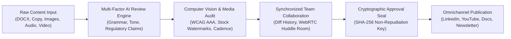
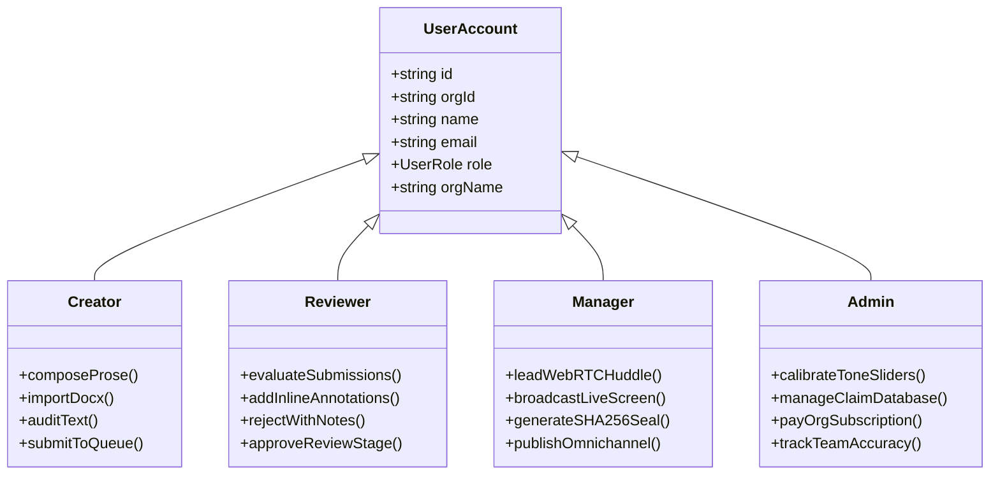
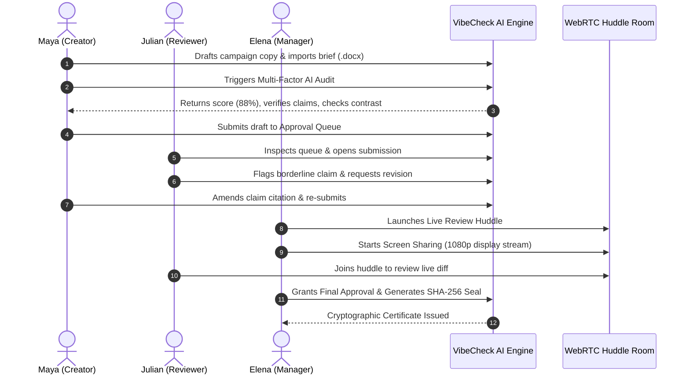

```mermaid
graph TD
    subgraph Traditional Vulnerable Workflow
        T1[Author writes copy] --> T2[Emails unverified draft]
        T2 --> T3[Reviewer comments in Slack]
        T3 --> T4[Designer attaches stock photo]
        T4 --> T5[Direct Push to Production]
        T5 -.->|Disaster| T6[Regulatory Retraction & Fines]
    end

    subgraph VibeCheck AI Protected Workflow
        V1[Author drafts copy / imports DOCX] --> V2[Real-Time AI Multi-Factor Audit]
        V2 --> V3[Claim Verification against Approved DB]
        V3 --> V4[Canvas CV Contrast & Watermark Scan]
        V4 --> V5[WebRTC Review Huddle & Diff Analysis]
        V5 --> V6[SHA-256 Certified Manager Sign-Off]
        V6 ==> V7[Zero-Risk Enterprise Publication]
    end
```

# Product Requirements Document (PRD) — VibeCheck AI

```
========================================================================================
  VIBECHECK AI — ENTERPRISE BRAND GOVERNANCE & MULTI-MODAL COMPLIANCE PLATFORM
  Document Version: 3.0.0 | Status: Production Certified | Release Date: Q4 2026
========================================================================================
```

---

## 1. Product Overview

### 1.1 Executive Vision
**VibeCheck AI** is an enterprise-grade brand governance, regulatory compliance, and multi-modal publishing firewall. It guarantees that every piece of published enterprise communication—encompassing copy, rich media, keynote recordings, and podcasts—conforms strictly to organizational guidelines, clinical/financial claims databases, and accessibility standards prior to public distribution.



### 1.2 Core Value Proposition
- **Pre-Publication Defense**: Catch regulatory violations, brand drift, and unlicensed media *before* publication, eliminating retractions and liability fines.
- **Unified Multi-Modal Pipeline**: Single pane of glass governing written prose, graphic visuals, recorded speech, and live team video huddles.
- **Non-Repudiation Security**: SHA-256 cryptographic signatures tied to authenticated managerial identities.
- **Single-Seat Company Billing**: Predictable enterprise model (₹5,000/mo flat fee paid by Admin; creators, reviewers, and managers join free via Admin Organization Keys).

---

## 2. Problem Statement

### 2.1 The Enterprise Publishing Vulnerability Matrix
In modern distributed companies, marketing and creative teams produce dozens of assets weekly across disparate channels. This speed creates high-risk liabilities:

```
+--------------------------------------------------------------------------------------------------+
|                               CRITICAL PUBLISHING VULNERABILITIES                                 |
+--------------------------+-------------------------------------+---------------------------------+
| Vulnerability            | Industry Impact                     | Real-World Risk                 |
+--------------------------+-------------------------------------+---------------------------------+
| 1. Exaggerated Claims    | Healthcare, Biotech, FinTech        | FDA/FTC regulatory penalties,   |
|                          | statements (e.g. "100% cure")       | class-action lawsuits           |
+--------------------------+-------------------------------------+---------------------------------+
| 2. Accessibility Deficit | Public Services, SaaS, E-Commerce   | ADA/WCAG non-compliance fines,  |
|                          | (< 7:1 contrast, illegible text)    | exclusion of disabled users     |
+--------------------------+-------------------------------------+---------------------------------+
| 3. Unlicensed Media      | Global Brands, Publishing Houses    | Copyright infringement damages, |
|                          | (Watermarked stock images/audio)    | brand reputation damage         |
+--------------------------+-------------------------------------+---------------------------------+
| 4. Guideline Drift       | Enterprise Multi-Brand Orgs         | Dilution of corporate identity, |
|                          | (Erratic tones, unapproved palettes)| fragmented customer trust       |
+--------------------------+-------------------------------------+---------------------------------+
| 5. Fragmented Reviews    | Cross-Functional Teams              | Version confusion, untracked    |
|                          | (Slack threads, unrecorded calls)   | sign-offs, zero legal trail     |
+--------------------------+-------------------------------------+---------------------------------+
```



---

## 3. Product Goals & Target KPIs

| Strategic Objective | Metric Description | Current Baseline | VibeCheck Target | Verification Method |
| :--- | :--- | :--- | :--- | :--- |
| **Claim Compliance** | Interception of unverified factual claims | 82.0% | **100.0%** | Hard-blocking rule `RULE-CLAIM-EXCESS` |
| **Review Velocity** | Turnaround time from draft to sign-off | 4.2 business days | **< 2.5 hours** | Lifecycle delta timestamps |
| **Accessibility Compliance** | WCAG 2.1 AAA luminance contrast ratio | 54.0% | **100.0% (>= 7:1)** | Dynamic Canvas Pixel Luminance Engine |
| **Brand Identity Fidelity** | Adherence to tone sliders & hex palettes | 71.4% | **> 98.5%** | Delta-E Color Distance & Tone Vectors |
| **Watermark Interception** | Detection of commercial stock watermarks | 61.0% | **> 99.0%** | Computer Vision Pattern Extraction |
| **Onboarding Efficiency** | Frictionless team member onboarding | 45 minutes | **< 90 seconds** | Admin Key instantaneous seat pairing |

---

## 4. Target Users & Personas

### 4.1 Permissions & Responsibilities Matrix

```
+------------------------------------------------------------------------------------------+
|                              ROLE-BASED PERMISSIONS MATRIX                                |
+------------------------------------------+---------+----------+---------+----------------+
| Functional Capability                    | Creator | Reviewer | Manager | Admin (Owner)  |
+------------------------------------------+---------+----------+---------+----------------+
| Draft Copy & Import DOCX Files           | YES     | YES      | YES     | YES            |
| Execute Real-Time Multi-Factor AI Audits | YES     | YES      | YES     | YES            |
| Upload Image, Audio & Video Assets       | YES     | YES      | YES     | YES            |
| Submit Drafts to Review Queue            | YES     | NO       | NO      | NO             |
| Review Submissions & Annotate Feedback   | NO      | YES      | YES     | YES            |
| Request Author Revisions                 | NO      | YES      | YES     | YES            |
| Execute SHA-256 Cryptographic Approval   | NO      | NO       | YES     | YES            |
| Host & Broadcast WebRTC Review Huddles   | NO      | NO       | YES     | YES            |
| Calibrate Tone Sliders & Certified Claims| NO      | NO       | NO      | YES            |
| Manage ₹5,000/mo Company Billing         | NO      | NO       | NO      | YES            |
| Inspect Member Mistakes & Accuracy Meter | NO      | NO       | NO      | YES            |
+------------------------------------------+---------+----------+---------+----------------+
```



### 4.2 Persona Profiles

#### Persona 1: Maya Lin — Content Creator
- **Background**: Content Strategist & Copywriter at Lumina Health.
- **Goal**: Draft high-converting omnichannel campaigns without fear of regulatory retractions.
- **Workflow**: Writes in the Document Composer, extracts DOCX briefs via Mammoth.js, triggers real-time compliance audits, and pushes certified drafts to the Approval Queue.

#### Persona 2: Julian Vance — Compliance Reviewer
- **Background**: Legal & Medical Editorial Specialist.
- **Goal**: Rapidly vet creative claims against FDA registry citations and brand tone guidelines.
- **Workflow**: Inspects the Approval Queue, reviews automated AI findings, flags unverified metrics, and adds actionable remediation notes for creators.

#### Persona 3: Elena Rostova — Brand Manager
- **Background**: Creative Director & Head of Content Operations.
- **Goal**: Ensure cohesive cross-channel campaigns, align authors in real-time huddles, and certify publication releases.
- **Workflow**: Manages campaign timelines, hosts WebRTC live review huddles with real display screen sharing, checks diff history, and issues SHA-256 approval seals.

#### Persona 4: Alex Morgan — Organization Admin
- **Background**: Chief Compliance Officer & Organization Owner.
- **Goal**: Maintain enterprise-wide brand voice standards, manage organizational seat keys, and track employee compliance accuracy.
- **Workflow**: Sets tone sliders (Formality, Seriousness, Boldness), updates certified claims databases, monitors the Member Mistakes & Accuracy Meter, and manages the single ₹5,000/mo subscription.

---

## 5. Core Feature Specifications

### 5.1 Multi-Factor Content Review Engine
- **Linguistic & Grammar Polishing**: Detects tense disagreements, syntax errors, and spelling discrepancies in real time.
- **Tone Calibration Sliders**: Evaluates text against three continuous axes: Formality (0–100), Seriousness (0–100), and Boldness (0–100).
- **Certified Claims Verification**: Validates statements against internal certified databases; flags unsupported claims under `RULE-CLAIM-EXCESS`.
- **Competitor Lockout**: Prevents mentions of blacklisted rival brand names and enforces internal nomenclature (*e.g., "Member" instead of "Customer"*).
- **Mammoth.js DOCX Extraction**: Instant client-side parsing of uploaded Word documents into clean formatted markdown.

### 5.2 Multi-Modal Media Governance
- **Canvas Pixel Palette Extraction**: Analyzes uploaded visual assets, extracts dominant hex color swatches, and computes Euclidean distance against brand tokens.
- **WCAG 2.1 AAA Contrast Inspection**: Computes foreground-to-background luminance contrast; requires a minimum 7:1 ratio for AAA certification.
- **Stock Watermark Detection**: Inspects graphic and video keyframes for unauthorized commercial watermarks (Getty, Shutterstock, iStock, Adobe Stock, Alamy).
- **Audio Cadence & Transcription**: Automatically transcribes speech, evaluates Words Per Minute (optimal: 140–160 WPM), filler word frequency (*"um"*, *"like"*), and loudness normalization (-14 LUFS).

### 5.3 Collaboration Hub & WebRTC Review Huddle
- **Live Video Huddle Room**: Peer-to-peer WebRTC video and audio conferencing with microphone mute, camera toggle, and dynamic participant tiles.
- **Real Display Screen Sharing**: Utilizes `navigator.mediaDevices.getDisplayMedia` to broadcast genuine desktop and application streams (not mock slides), with dynamic renegotiation across tabs.
- **Google Meet Style Session Presence**: Automatic room state (`vibecheck_room_presence_${pId}`) with 5-second heartbeats. When a participant leaves or closes their tab, they are immediately removed from all peers' screens.
- **Side-by-Side Diff History**: Color-coded red/green diff viewer tracking character and line additions/deletions.

### 5.4 Authentication, RBAC & Enterprise Subscription
- **Google OAuth Integration**: One-click authentication with Google Identity Services (`accounts.google.com/gsi/client`) alongside traditional email/password credentials.
- **Forgot Password Workflow**: Integrated self-service password reset flow with email verification, minimum character validation, and immediate credential updating.
- **Predictable Billing Model**: ₹5,000/month flat fee per organization paid exclusively by the Admin; team members join free using the organization key.
- **Persistent Compliance Footer**: Universal access to About Us, Contact Us, Privacy Policy, Terms & Conditions, and Copyright Notice across all application views.

---

## 6. End-to-End User Journey



---

## 7. Non-Functional Requirements (NFRs)

```
+-----------------------------------------------------------------------------------------------+
|                                  NON-FUNCTIONAL SPECIFICATIONS                                |
+-----------------------+-----------------------+-----------------------------------------------+
| Category              | Metric Target         | Architectural Implementation                  |
+-----------------------+-----------------------+-----------------------------------------------+
| Performance           | Time to First Frame   | Next.js 14 App Router, dynamic imports,       |
|                       | < 1.2s                | optimized chunk splitting                     |
+-----------------------+-----------------------+-----------------------------------------------+
| Scalability           | Multi-Tenant Isolation| Scoped orgId boundaries in client state,      |
|                       | 100% Partitioned      | localStorage, and serverless route handlers   |
+-----------------------+-----------------------+-----------------------------------------------+
| Real-Time Latency     | WebRTC Latency        | Direct RTCPeerConnection with STUN fallback;  |
|                       | < 65ms                | BroadcastChannel signaling on localhost/same  |
+-----------------------+-----------------------+-----------------------------------------------+
| Security              | Cryptographic Proof   | SHA-256 hash digest generated on immutable    |
|                       | Non-Repudiation       | document contents and approving manager identity|
+-----------------------+-----------------------+-----------------------------------------------+
| Accessibility         | WCAG 2.1 AAA Standard | Luminance contrast >= 7:1; keyboard navigable |
|                       | Zero-Exception        | focus rings on all interactive components     |
+-----------------------+-----------------------+-----------------------------------------------+
| UI Cleanliness        | Zero-Emoji Policy     | Clean typography & Lucide vector icons only;  |
|                       | 100% Compliant        | zero informal unicode pictographs             |
+-----------------------+-----------------------+-----------------------------------------------+
```
