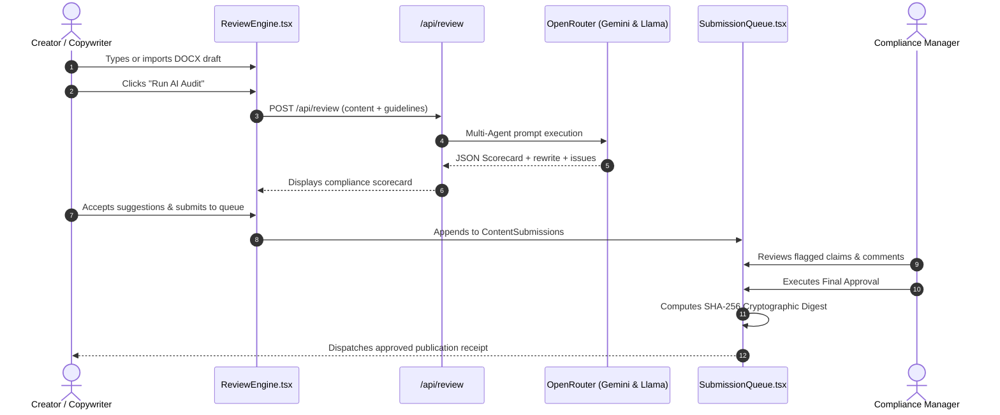

# Project Implementation & Codebase Architecture — VibeCheck AI

## 1. Codebase Overview & Technology Stack
VibeCheck AI is structured as a full-stack modular Next.js 14 App Router project utilizing:
- **Framework**: Next.js 14.2 (Node.js runtime)
- **Language**: TypeScript 5.0 (Strict mode enabled)
- **Styling**: Tailwind CSS 3.4 with custom `@tailwindcss/typography`
- **Component Icons**: Lucide React
- **Multimedia Processing**: Web Audio API, HTML5 Canvas CV, WebRTC MediaStreams, Mammoth.js

---

## 2. Directory Map & Module Manifest

```bash
VibeCheck AI/
├── Docs/                           # Complete Technical & Product Documentation
│   ├── PRD.md                      # Product Requirements Document
│   ├── Design.md                   # UI/UX & Sandstone Design Tokens
│   ├── Architecture.md             # Multi-tenant Architecture & WebRTC
│   ├── Database.md                 # Database Schema, ERD & Models
│   ├── API.md                      # REST Route Handlers Specification
│   ├── Agents.md                   # Multi-Agent Architecture & Scoring
│   ├── Project Implementation.md   # Component Map & Source Walkthrough
│   ├── setup&initilisation.md      # Installation, Config & Seed Accounts
│   ├── feature Development.md      # Feature Lifecycle & Extensibility
│   ├── Authentication &security.md # RBAC, Paywall & SHA-256 Crypto
│   ├── MCP connection.md           # Model Context Protocol Server Guide
│   ├── Integrations.md             # Enterprise Webhooks & Connectors
│   ├── Testing &QA.md              # Quality Assurance & Test Matrix
│   └── Debugging.md                # Troubleshooting & Disaster Recovery
├── src/
│   ├── app/
│   │   ├── api/
│   │   │   ├── extract-docx/route.ts       # Mammoth.js DOCX text extraction
│   │   │   ├── notify/route.ts             # Resend transactional email API
│   │   │   ├── review/route.ts             # Multi-agent text & claims audit
│   │   │   ├── review-image/route.ts       # Vision AI & stock watermark detection
│   │   │   ├── transcribe-audio/route.ts   # OpenRouter speech-to-text API
│   │   │   └── upload/route.ts             # Cloudinary asset uploader
│   │   ├── globals.css                     # Tailwind imports & custom animations
│   │   ├── layout.tsx                      # Root HTML shell & font definitions
│   │   └── page.tsx                        # Master state orchestrator & tab router
│   ├── components/
│   │   ├── AnalyticsInsights.tsx           # Dynamic compliance KPI & creator benchmarks
│   │   ├── AssetLibrary.tsx                # Brand asset manager (logos, guidelines)
│   │   ├── AuditLogs.tsx                   # Security log viewer
│   │   ├── AuthScreen.tsx                  # Multi-tenant registration & login
│   │   ├── BrandGuidelinesBuilder.tsx      # Tone sliders, claim ledger & color tokens
│   │   ├── CollaborationHub.tsx            # Multi-project timelines & WebRTC huddle
│   │   ├── CookieConsentBanner.tsx         # GDPR/ePrivacy first-visit consent banner
│   │   ├── DiffViewer.tsx                  # Side-by-side text diff comparison
│   │   ├── DocumentEditor.tsx              # Rich formatted markdown editor
│   │   ├── LandingPage.tsx                 # Modern marketing hero & workflow overview
│   │   ├── LegalSupportModal.tsx           # Interactive 5-tab legal & support modal
│   │   ├── MediaAudit.tsx                  # Audio & video governance inspector
│   │   ├── Navbar.tsx                      # Top workspace header & profile menu
│   │   ├── ReviewEngine.tsx                # Interactive content auditor & scorecard
│   │   ├── RoleDashboard.tsx               # Tailored portal per user role
│   │   ├── SettingsModal.tsx               # Organization keys & billing details
│   │   ├── Sidebar.tsx                     # Role-adaptive navigation sidebar
│   │   ├── SubscriptionCheckoutModal.tsx   # ₹5,000/mo subscription payment gateway
│   │   ├── SubmissionQueue.tsx             # Editorial approval pipeline & SHA-256 signing
│   │   └── WorkflowIntegrations.tsx        # YouTube, Canva, Teams, GitHub connectors
│   └── lib/
│       ├── accessibility-cv.ts             # Canvas pixel extraction & contrast algorithms
│       ├── cloudinary.ts                   # Cloudinary SDK wrapper
│       ├── default-data.ts                 # Demo orgs, guidelines, projects & sample media
│       ├── image-analysis.ts               # Vision AI & stock watermark detection
│       ├── openrouter.ts                   # OpenRouter multi-model LLM interface
│       ├── resend.ts                       # Resend email notification client
│       └── types.ts                        # Strict TypeScript domain interfaces
├── public/                                 # Static icons & branding assets
├── .env.local                              # Private environment secrets (gitignored)
├── package.json                            # Project dependencies & build scripts
├── tailwind.config.ts                      # Custom sand & bronze palette configuration
└── tsconfig.json                           # Strict TypeScript compiler options
```

---

## 3. Component Interaction Flow & Lifecycle


