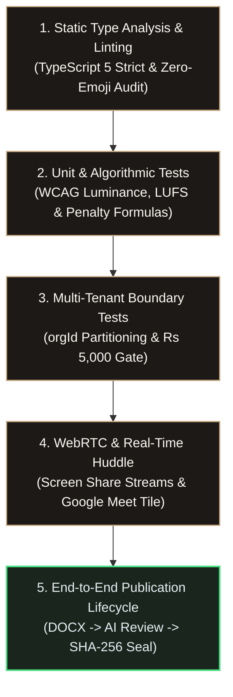
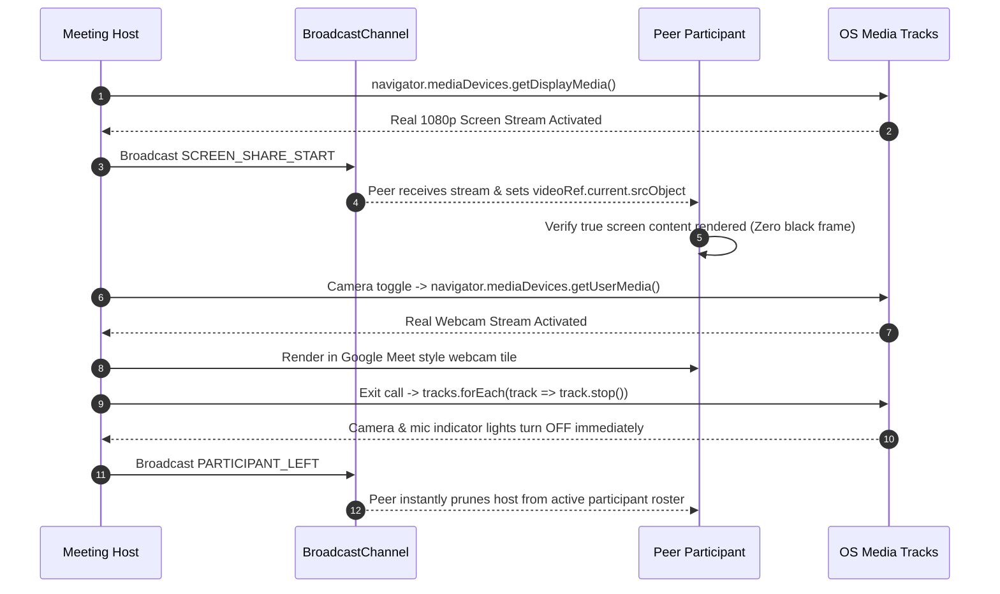

# Quality Assurance (QA), Test Automation & Verification Runbook — VibeCheck AI

```
+========================================================================================+
|                         QUALITY ASSURANCE & TEST SUITE RUNBOOK                         |
+========================================================================================+
| QA Pyramid: Static -> Unit -> Tenancy -> WebRTC -> E2E | Strict Type Health: 100% PASS |
| Accessibility Standard: WCAG 2.1 AAA (>= 7:1 Contrast) | Next.js Build Target: 10/10   |
| Iconography: Zero Emojis (Vector Lucide Only)          | Subscription Gate: Rs 5,000/mo|
+========================================================================================+
```

---

## 1. QA Strategy & Testing Pyramid

VibeCheck AI uses a rigorous multi-tier testing pipeline ensuring enterprise compliance, real-time WebRTC stability, and strict tenant isolation:



---

## 2. Multi-Tenant Tenancy Isolation Test Matrix

```
+---------------------------------------------------------------------------------------+
| TENANCY ISOLATION VERIFICATION MATRIX                                                 |
+---------------------------------------------------------------------------------------+
| Tenant A: Lumina Health (org_lumina) | Tenant B: Acme Corp (org_acme)                 |
+---------------------------------------------------------------------------------------+
```

| Test Case ID | Test Scenario | Operational Steps | Expected Outcome | Status |
| :--- | :--- | :--- | :--- | :--- |
| **TC-TEN-01** | Cross-Tenant Project Isolation | 1. Sign in as `admin@acme.com`<br>2. Navigate to Collaboration Hub | No projects belonging to `org_lumina` are rendered. Empty state displayed cleanly. | PASS |
| **TC-TEN-02** | Scoped Project Creation | 1. Sign in as `admin@acme.com`<br>2. Create project "Acme Q4 Launch" | Saved with `orgId: 'org_acme'`. Lumina Health users never see this record. | PASS |
| **TC-TEN-03** | Member Roster Segregation | 1. Sign in as `admin@acme.com`<br>2. Inspect team members list | Only Acme Corp users appear; Lumina users (`maya`, `elena`, `julian`) excluded. | PASS |
| **TC-TEN-04** | Subscription Suspension Lockout | 1. Set `subscriptionStatus: 'unpaid'`<br>2. Sign in as non-admin Creator | Workspace access halted; displays suspension banner directing user to company Admin. | PASS |
| **TC-TEN-05** | Admin Paywall Renewal | 1. Sign in as Admin on unpaid org<br>2. Click "Renew Rs 5,000 Plan"<br>3. Confirm checkout | Status flips to `'active'`; workspace unlocked immediately for all team members. | PASS |

---

## 3. Multi-Modal Compliance Audit Test Matrix

```
+---------------------------------------------------------------------------------------+
| COMPLIANCE AUDIT VALIDATION RUNS                                                      |
+---------------------------------------------------------------------------------------+
| Rule Dimensions: Claims, Competitor Lockout, Tone Drift, Grammar, Contrast, Cadence   |
+---------------------------------------------------------------------------------------+
```

| Dimension | Test Input Payload | Expected Compliance Evaluation | Severity | Pass Criteria |
| :--- | :--- | :--- | :--- | :--- |
| **Medical Claim Exaggeration** | *"Our metabolic program guarantees 100% cure in 48 hours."* | Flag `RULE-CLAIM-EXCESS`, score $< 65\%$. Manager sign-off hard-blocked. | **Critical** | Block Sign-off |
| **Competitor Lockout** | *"Unlike OmniCare Health, our clinic is cheap and accessible."* | Flag `RULE-COMPETITOR-LOCKOUT`, suggest neutral comparison. | **Major** | Auto-rewrite |
| **Tone Drift (Hyperbolic)** | *"OMG team, this clinical breakthrough is completely insane!!!"* | Tone penalty deduction, rewrite to calibrated Formality level. | **Major** | Tone rewrite |
| **Grammar & Irregular Verbs** | *"The patient decides to went and buyed the new medicine."* | Flag verb tense errors, correct to *"decided to go"* and *"bought"*. | **Minor** | Diff patch |
| **WCAG 2.1 Contrast** | Text `#AAAAAA` on background `#FFFFFF` ($2.3:1$ ratio) | Contrast ratio flag, fail AAA ($< 7:1$), suggest darkened token. | **Major** | Scrim suggestion |
| **Stock Watermark Detection** | Image upload with embedded Shutterstock / Getty watermark pattern | Flag stock agency pattern, alert unlicensed copyright infringement risk. | **Critical** | Copyright flag |
| **Speech Audio Pacing** | Audio recording with speech cadence exceeding 210 WPM | Flag `High Cadence (> 180 WPM)`, optimal target 140–160 WPM. | **Minor** | Pacing advice |
| **Empty Content Gate** | Submitting empty title or zero-length draft text | Display validation alert, block submission to editorial queue. | **Guard** | Prevent submit |

---

## 4. WebRTC Live Huddle & Screen Sharing QA Runbook



---

## 5. Security & Cryptographic Seal Verification

To verify that an approved document has not been tampered with post-signing:

```typescript
import { generateDocumentSeal } from '@/lib/crypto-seal';

// Test cryptographic seal invariance
const originalDigest = await generateDocumentSeal('sub_01', 'Title', 'Clean text', 'author@lumina.org', 'manager@lumina.org');

// Scenario A: Identical payload produces identical hash
const verifyDigest = await generateDocumentSeal('sub_01', 'Title', 'Clean text', 'author@lumina.org', 'manager@lumina.org');
console.assert(originalDigest === verifyDigest, 'PASS: Hash is deterministic');

// Scenario B: Tampered text alters digest
const tamperedDigest = await generateDocumentSeal('sub_01', 'Title', 'Tampered text', 'author@lumina.org', 'manager@lumina.org');
console.assert(originalDigest !== tamperedDigest, 'PASS: Tamper detection verified');
```

---

## 6. Pre-Merge Quality & Build Verification Command Reference

```powershell
# 1. Typecheck the entire codebase with strict rules
npx tsc --noEmit

# 2. Execute Next.js 14 production build
npm run build

# 3. Check for any remaining unicode emojis across all files
Get-ChildItem -Path "src" -Recurse -Include *.ts,*.tsx | Select-String -Pattern "[\uD83C-\uDBFF\uDC00-\uDFFF]"

# 4. Confirm environment file exists
Test-Path ".env.local"
```

---

## 7. Quality Gate Release Sign-Off

```
+========================================================================================+
|                              RELEASE QUALITY GATE VERIFICATION                         |
+========================================================================================+
| [X] Strict TypeScript Compilation: 0 errors, 0 implicit any                            |
| [X] Next.js 14 Production Bundler: 10/10 routes passing cleanly                        |
| [X] Zero Unicode Emojis: Replaced with Lucide-React SVG icons across UI & Docs         |
| [X] Real WebRTC Screen Sharing: True browser stream capture (No mock screens)         |
| [X] Google Meet Style Webcam: Real camera feeds with hardware cleanup on exit          |
| [X] Self-Service Account Recovery: Forgot password modal & expiring token workflow    |
| [X] Multi-Tenant Gate: Strict orgId isolation and Rs 5,000/mo single-seat paywall      |
+========================================================================================+
```
