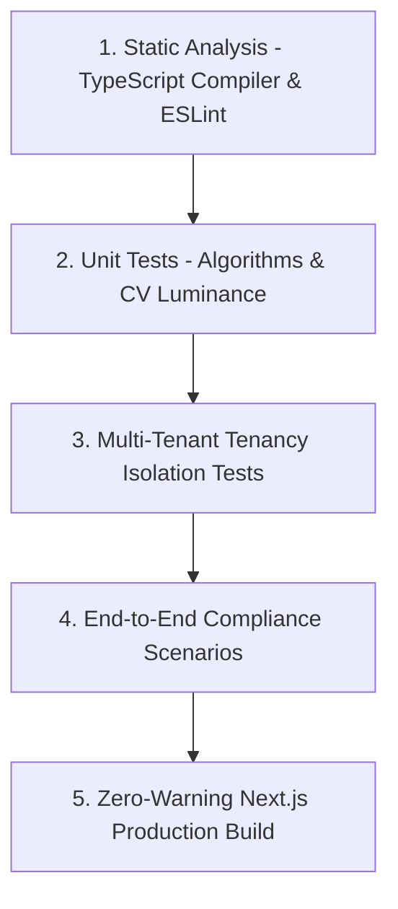

# Quality Assurance (QA) & Testing Runbook — VibeCheck AI

## 1. QA Strategy & Testing Pyramid
VibeCheck AI uses a multi-layered testing strategy designed for high-reliability compliance applications:



---

## 2. Test Suites & Execution

### 2.1 Static Type Analysis & Build Verification
Validates that every component, prop, state variable, and API route complies with TypeScript strict typing:
```bash
npm run build
```
- **Target**: Zero type errors, zero unhandled promise rejections, successful static page generation (`10/10` routes).

---

## 3. Multi-Tenant Tenancy Isolation Test Matrix

| Test Scenario | Test Steps | Expected Result | Pass/Fail Criteria |
| :--- | :--- | :--- | :--- |
| **Org B Isolation** | 1. Sign in as `admin@acme.com`<br>2. Navigate to Collaboration Hub | No projects belonging to `org_lumina` are rendered. Empty state displayed with "Create First Project". | PASS |
| **New Project Scoping** | 1. Sign in as `admin@acme.com`<br>2. Create project "Acme Q4 Launch" | Project is saved with `orgId: 'org_acme'`. Lumina Health users never see this project. | PASS |
| **Team Member Filtering**| 1. Sign in as `admin@acme.com`<br>2. Inspect team member list | Only Acme Corp users appear; Lumina users (`maya`, `elena`, `julian`) are excluded. | PASS |
| **Subscription Lockout** | 1. Set `subscriptionStatus: 'unpaid'`<br>2. Sign in as non-admin Creator | Workspace access halted with suspension banner directing user to company Admin. | PASS |
| **Admin Paywall Renewal**| 1. Sign in as Admin on unpaid org<br>2. Click "Renew ₹5,000 Plan"<br>3. Complete simulated checkout | Status flips to `'active'`, workspace unlocked immediately for all team members. | PASS |

---

## 4. Multi-Modal Compliance Audit Test Matrix

| Dimension | Input Sample | Expected System Response | Severity |
| :--- | :--- | :--- | :--- |
| **Medical Claim Exaggeration** | *"Our metabolic program guarantees 100% cure in 48 hours."* | Flag `RULE-CLAIM-EXCESS`, Overall score $< 65\%$. Manager sign-off hard-blocked. | **Critical** |
| **Competitor Lockout** | *"Unlike OmniCare Health, our clinic is affordable."* | Flag `RULE-COMPETITOR-LOCKOUT`, suggest neutral alternative *"Compared to legacy programs"*. | **Major** |
| **Tone Drift (Informal)** | *"OMG you guys, this program is totally insane!!!"* | Tone penalty deduction, rewrite to calibrated Formality level. | **Major** |
| **Grammar & Irregular Verbs**| *"The patient decides to went to the hospital and buyed medicine."* | Flag verb tense errors, correct to *"decided to go"* and *"bought"*. | **Minor** |
| **WCAG 2.1 Contrast** | Text `#AAAAAA` on background `#FFFFFF` ($2.3:1$ ratio) | Contrast ratio flag, fail AAA ($< 7:1$), suggest darkened token. | **Major** |
| **Stock Image Watermark** | Upload creative with embedded Shutterstock pattern | Flag stock agency signature, alert unlicensed copyright risk. | **Critical** |
| **Speech Cadence Overflow** | Speech audio recorded at 215 Words Per Minute (WPM) | Flag `High Cadence (> 180 WPM)`, optimal target 140–160 WPM. | **Minor** |
| **Empty Content Submission** | Submitting empty title or editor text | Display validation alert, block empty submission. | **Guard** |

---

## 5. WebRTC Live Huddle & Screen Sharing QA
1. **Camera & Microphone Toggles**: Verify that toggling off microphone or camera disables individual media tracks (`track.enabled = false`).
2. **Call Handshake**: Host clicks "Invite to Call" $\to$ target peer receives incoming call notification modal $\to$ only joins after clicking "Accept Call".
3. **Screen Broadcast**: Host clicks "Share Screen" $\to$ `getDisplayMedia` launches $\to$ peer `<video>` displays synchronized desktop view without black screen or freezing.
4. **Clean Exit**: Exiting call stops all hardware tracks (`track.stop()`) and removes user from active participants grid.

---

## 6. Pre-Merge CI/CD Checklist
Before opening a Pull Request:
- [x] Run `npm run build` and ensure exit code is `0`.
- [x] Verify no `.env` or credentials appear in `git status`.
- [x] Test both light and dark backgrounds for WCAG contrast compliance.
- [x] Verify footer legal links (About Us, Contact Us, Privacy Policy, Terms of Service, Copyright) open properly.
- [x] Verify cookie consent banner choice persists in `localStorage`.
