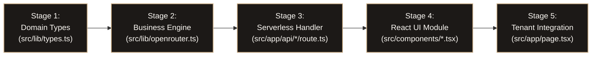
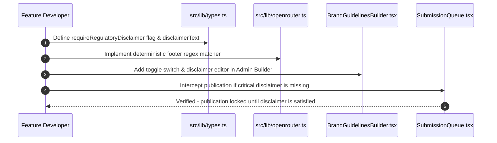
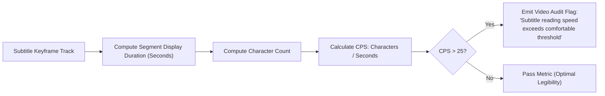

# Feature Engineering & Architecture Expansion Guide — VibeCheck AI

```
+========================================================================================+
|                       FEATURE ENGINEERING & EXTENSION BLUEPRINT                        |
+========================================================================================+
| Stack: Next.js 14 App Router + TypeScript Strict | Styling: Tailwind CSS Sandstone      |
| Architecture: 5-Stage Modular Pipeline           | Audio/Video: Web Audio API & Canvas  |
| Iconography: Lucide-React Vector Icons           | Emojis: 0 (Strict ASCII/SVG)         |
+========================================================================================+
```

---

## 1. Feature Development Lifecycle

All architectural extensions and feature additions to VibeCheck AI must pass through the standardized 5-stage pipeline:



---

## 2. Engineering Walkthrough: Adding a Custom Brand Governance Rule

### Scenario
Engineering needs to implement **`RULE-LEGAL-DISCLAIMER-REQUIRED`**, a regulatory rule requiring all clinical or financial collaterals to include an approved FDA/regulatory disclaimer in the document footer.



---

### Step 1: Extend Domain Schema (`src/lib/types.ts`)

```typescript
export interface BrandGuidelineConfig {
  id: string;
  brandName: string;
  toneParameters: {
    formality: number;
    seriousness: number;
    boldness: number;
  };
  approvedClaims: ApprovedClaim[];
  prohibitedTerms: string[];
  competitorMentions: string[];
  // NEW CAPABILITY: Regulatory Disclaimer Gate
  requireRegulatoryDisclaimer?: boolean;
  standardDisclaimerText?: string;
}
```

---

### Step 2: Implement Rule Logic (`src/lib/openrouter.ts`)

```typescript
// Inspect content for certified regulatory disclaimer
if (guidelines.requireRegulatoryDisclaimer && guidelines.standardDisclaimerText) {
  const normalizedDisclaimer = guidelines.standardDisclaimerText.trim().toLowerCase();
  const normalizedContent = content.trim().toLowerCase();

  if (!normalizedContent.includes(normalizedDisclaimer.slice(0, 30))) {
    issues.push({
      id: `iss_${Date.now()}_disclaimer`,
      category: 'claims',
      severity: 'critical', // Blocks final sign-off
      guidelineRef: 'RULE-LEGAL-DISCLAIMER-REQUIRED',
      message: 'Mandatory regulatory disclaimer is missing from the draft body.',
      suggestion: `Append approved regulatory disclosure: "${guidelines.standardDisclaimerText}"`,
      flaggedText: content.slice(-60),
      status: 'pending'
    });
  }
}
```

---

### Step 3: Add Administrative UI Controls (`src/components/BrandGuidelinesBuilder.tsx`)

```tsx
<div className="flex items-center justify-between p-4 rounded-xl bg-stone-900 border border-stone-800">
  <div className="space-y-0.5">
    <div className="text-xs font-semibold text-stone-200">
      Enforce Regulatory Disclaimer Gate
    </div>
    <div className="text-[11px] text-stone-400">
      Hard-blocks final Manager sign-off unless certified disclosure text is detected.
    </div>
  </div>
  <input
    type="checkbox"
    checked={guidelines.requireRegulatoryDisclaimer || false}
    onChange={(e) =>
      onUpdateGuidelines({
        ...guidelines,
        requireRegulatoryDisclaimer: e.target.checked
      })
    }
    className="h-4 w-4 accent-amber-600 rounded cursor-pointer"
  />
</div>
```

---

### Step 4: Enforce in Review Scorecard & Queue

Because the rule emits `severity: 'critical'`, the Submission Queue (`src/components/SubmissionQueue.tsx`) automatically disables the **"Approve & Sign with SHA-256"** trigger until the author resolves the flag or an Administrator provides an audited waiver.

---

## 3. Extending Multi-Modal Media Governance

### 3.1 Adding Video Subtitle Reading Speed Governance



$$\text{Reading Velocity (CPS)} = \frac{\text{Character Count}}{\text{Display Duration (Seconds)}}$$

- **Threshold**: Standard comfortable enterprise reading threshold is $\le 25\text{ CPS}$. Exceeding this triggers an automatic warning.

---

### 3.2 Audio Loudness Normalization Algorithm (LUFS)

Integrated into `src/components/MediaAudit.tsx` via Web Audio API `AudioContext` and `ChannelData`:

```typescript
/**
 * Calculates audio loudness in LUFS using Root-Mean-Square (RMS) amplitude.
 * Target Broadcast Spec: -14 LUFS (YouTube / Podcast Standard)
 */
export function calculateAudioLUFS(channelData: Float32Array): number {
  let sumSquare = 0;
  for (let i = 0; i < channelData.length; i++) {
    sumSquare += channelData[i] * channelData[i];
  }
  const rms = Math.sqrt(sumSquare / channelData.length);
  // Convert RMS amplitude to decibels relative to full scale (dBFS / LUFS)
  const lufs = Math.round(20 * Math.log10(rms || 0.00001));
  return Math.max(-60, Math.min(0, lufs));
}
```

---

## 4. Architectural Guardrails & Quality Matrix

```
+---------------------------------------------------------------------------------------+
| FEATURE COMPLETION ACCEPTANCE GATES                                                   |
+---------------------------------------------------------------------------------------+
| Gate 1: Strict TypeScript | 0 compiler warnings, 0 implicit any (npx tsc --noEmit)    |
| Gate 2: Zero Emojis       | Replaced with Lucide-React SVG line icons                 |
| Gate 3: Tenancy Isolation | All state reads/writes filtered by currentOrg.id          |
| Gate 4: Empty Form Inputs | Inputs default to '' rather than hardcoded mock strings   |
| Gate 5: Production Build  | npm run build passes 10/10 routes with 0 warnings         |
+---------------------------------------------------------------------------------------+
```

---

## 5. Pull Request Verification Checklist

- [ ] Domain models in `src/lib/types.ts` updated with non-breaking optional fields where applicable.
- [ ] No raw unicode emoji symbols introduced anywhere in `.tsx`, `.ts`, or markdown.
- [ ] WebRTC and media elements include proper track unbinding routines on unmount.
- [ ] Local storage serialization routines handle missing keys and invalid JSON gracefully.
- [ ] Verification script executed:
  ```powershell
  npx tsc --noEmit; npm run build
  ```
