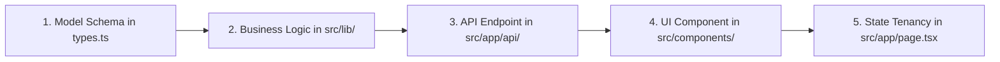

# Feature Development & Contribution Guide — VibeCheck AI

## 1. Feature Development Lifecycle
All new capabilities added to VibeCheck AI follow an established 5-stage engineering lifecycle:



---

## 2. Walkthrough: Implementing a New Brand Rule

Suppose your team needs a new rule: **`RULE-LEGAL-DISCLAIMER-REQUIRED`**, which mandates that financial or clinical copy must include an approved FDA/regulatory disclaimer in the footer.

### Stage 1: Extend Domain Types (`src/lib/types.ts`)
```ts
export interface BrandGuidelineConfig {
  // Existing properties...
  requireRegulatoryDisclaimer?: boolean;
  standardDisclaimerText?: string;
}
```

### Stage 2: Implement Rule Logic (`src/lib/openrouter.ts`)
```ts
if (guidelines.requireRegulatoryDisclaimer && guidelines.standardDisclaimerText) {
  const hasDisclaimer = content.toLowerCase().includes(
    guidelines.standardDisclaimerText.toLowerCase().slice(0, 30)
  );
  if (!hasDisclaimer) {
    issues.push({
      id: `iss_${Date.now()}_disclaimer`,
      category: 'claims',
      severity: 'critical',
      guidelineRef: 'RULE-LEGAL-DISCLAIMER-REQUIRED',
      message: 'Mandatory regulatory disclaimer is missing from draft copy.',
      suggestion: `Append standard disclaimer: "${guidelines.standardDisclaimerText}"`,
      flaggedText: content.slice(-50),
      status: 'pending',
    });
  }
}
```

### Stage 3: Add UI Controls (`src/components/BrandGuidelinesBuilder.tsx`)
Add a toggle switch and text input for the disclaimer in the Admin guidelines builder:
```tsx
<div className="flex items-center justify-between p-3 rounded-xl bg-sand-50 border border-sand-200">
  <div>
    <div className="text-xs font-bold text-sand-900">Enforce Mandatory Regulatory Disclaimer</div>
    <div className="text-[11px] text-sand-600">Requires certified disclaimer text in all public copy.</div>
  </div>
  <input
    type="checkbox"
    checked={guidelines.requireRegulatoryDisclaimer || false}
    onChange={(e) => onUpdateGuidelines({ ...guidelines, requireRegulatoryDisclaimer: e.target.checked })}
    className="h-4 w-4 accent-[#3C311F]"
  />
</div>
```

### Stage 4: Enforce in Queue & Scorecard
Because the severity was marked `'critical'`, the submission queue in `SubmissionQueue.tsx` will automatically intercept the draft, flag `RULE-LEGAL-DISCLAIMER-REQUIRED`, and disable the Manager sign-off button until the author resolves the flag.

---

## 3. Extending Multi-Modal Governance

### 3.1 Adding Video Governance Checks
To add a new video check (e.g. **Subtitle Reading Speed**):
1. In `src/components/MediaAudit.tsx`, inspect speech segment durations against keyframe subtitle character counts:
   $$\text{CPS} = \frac{\text{Character Count}}{\text{Display Duration (Seconds)}}$$
   If $\text{CPS} > 25$, flag as *"Subtitle speed exceeds comfortable reading threshold"*.
2. Add the flag to `videoAudit.flags`.

### 3.2 Adding Audio Loudness Normalization Check
Audio loudness is calculated in `MediaAudit.tsx` using Root-Mean-Square (RMS) amplitude mapped to LUFS:
```ts
const calculateLUFS = (channelData: Float32Array): number => {
  let sum = 0;
  for (let i = 0; i < channelData.length; i++) {
    sum += channelData[i] * channelData[i];
  }
  const rms = Math.sqrt(sum / channelData.length);
  return Math.round(20 * Math.log10(rms || 0.0001));
};
```
Target: **$-14\text{ LUFS}$** (standard YouTube/podcast broadcast spec).

---

## 4. Engineering Principles & Guardrails
- **Tenancy Isolation**: Never query or display data across organizations. All queries must filter by `currentOrg.id`.
- **Form Scaffolding**: Input fields and textareas must always initialize to empty strings (`''`) rather than hardcoded mock copy.
- **Git Hygiene**: Never commit keys or secrets. Run `git status` before committing to ensure `.env.local` remains ignored.
- **Zero-Error Build Standard**: Run `npm run build` locally before opening pull requests.
