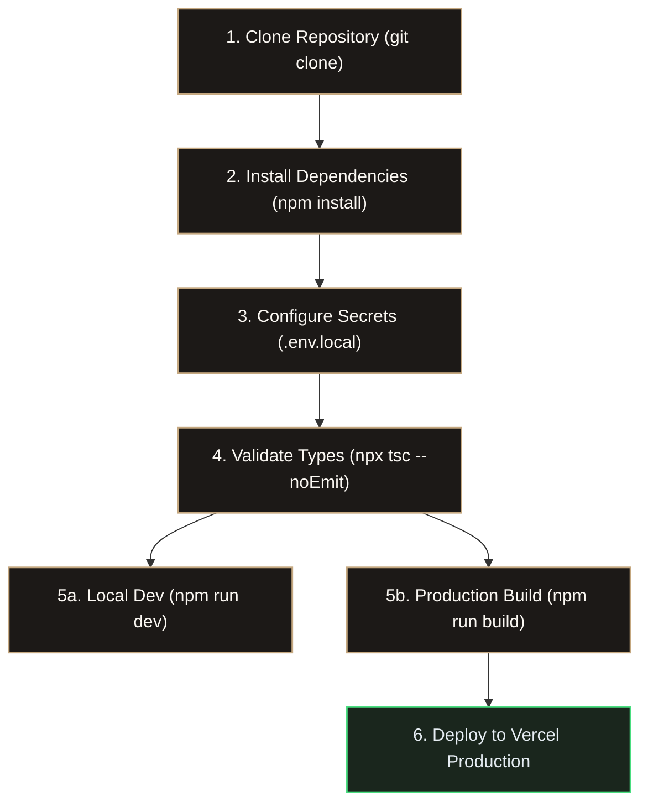
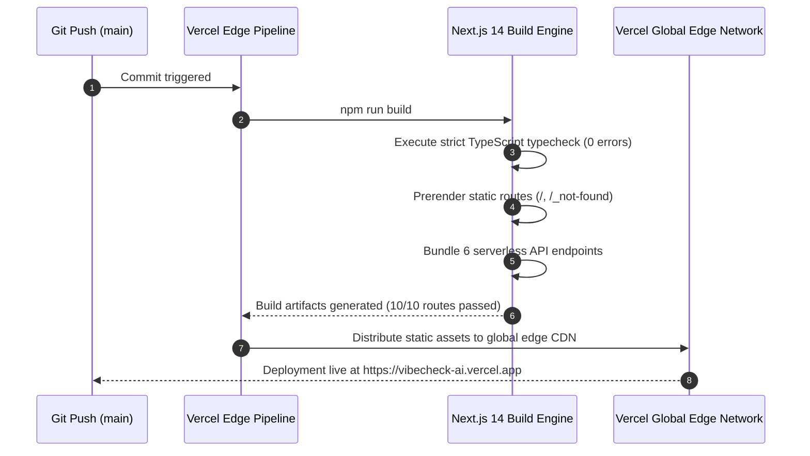

# Setup, Initialization & Deployment Operations — VibeCheck AI

```
+========================================================================================+
|                        SETUP, ENVIRONMENT & DEPLOYMENT RUNBOOK                         |
+========================================================================================+
| Node Engine: >= 18.17.0 (Node 20+ LTS recommended) | Deployment Target: Vercel Edge   |
| Bundler: Next.js 14 App Router (Turbopack ready)   | Build Health: Strict Clean        |
| Seed Tenancies: Lumina Health & Acme Corp          | Emojis: 0 (Strict ASCII/SVG)      |
+========================================================================================+
```

---

## 1. Quickstart Architecture & Setup Flow



---

## 2. Environment Prerequisites & Hardware Matrix

| Parameter | Minimum Requirement | Recommended Specification |
| :--- | :--- | :--- |
| **Node.js** | `v18.17.0` | `v20.11.0` (LTS) |
| **Package Manager** | `npm` 9.0+ / `pnpm` 8.0+ | `npm` 10.2+ |
| **Memory (RAM)** | 4 GB | 8 GB+ (for fast compilation) |
| **Disk Space** | 500 MB (with node_modules) | 2 GB SSD |
| **Operating System** | macOS, Linux, Windows 10/11 | Any POSIX or PowerShell shell |

---

## 3. Environment Secrets Matrix (`.env.local`)

```
+---------------------------------------------------------------------------------------+
| ENVIRONMENT CONFIGURATION MANIFEST                                                    |
+---------------------------------------------------------------------------------------+
| File: .env.local (Root directory) | Status: Strictly gitignored                       |
+---------------------------------------------------------------------------------------+
```

| Variable Name | Required | Sensitivity | Purpose / Source |
| :--- | :---: | :---: | :--- |
| `NEXT_PUBLIC_APP_NAME` | YES | Public | Display brand header (`VibeCheck AI`) |
| `OPENROUTER_API_KEY` | YES | Secret | Multi-agent review & speech transcription (openrouter.ai) |
| `GEMINI_API_KEY` | NO | Secret | Optional direct Google AI Studio API access |
| `SUPABASE_PUBLISHABLE_KEY` | NO | Public | Client-side tenant synchronization |
| `CLOUDINARY_CLOUD_NAME` | NO | Public | Creative banner CDN cloud storage |
| `CLOUDINARY_API_KEY` | NO | Secret | Cloudinary asset management key |
| `CLOUDINARY_API_SECRET` | NO | Secret | Cloudinary asset signature secret |
| `RESEND_API_KEY` | NO | Secret | Transactional reviewer email dispatch (resend.com) |

#### Sample `.env.local` File Template
```bash
# Core Enterprise Settings
NEXT_PUBLIC_APP_NAME="VibeCheck AI"
OPENROUTER_API_KEY="sk-or-v1-xxxxxxxxxxxxxxxxxxxxxxxx"

# Optional Cloud Infrastructure
CLOUDINARY_CLOUD_NAME="vibecheck-cloud"
CLOUDINARY_API_KEY="123456789012345"
CLOUDINARY_API_SECRET="abcdefghijklmnopqrstuvwxyz01"
RESEND_API_KEY="re_123456789abcdef"
```

---

## 4. Local Development Execution

```powershell
# 1. Install dependencies
npm install

# 2. Launch Next.js 14 development server with hot-reload
npm run dev
```

Navigate to `http://localhost:3000` in Google Chrome or Microsoft Edge.

---

## 5. Vercel Production Build & Deployment Pipeline



### Build Verification Command
```powershell
# Ensure zero implicit any, zero compile errors, and passing bundles
npx tsc --noEmit
npm run build
```

---

## 6. Seed Accounts & Preconfigured Demo Credentials

VibeCheck AI comes seeded with preconfigured multi-tenant organizations to verify role boundaries instantly:

```
+-------------------------------------------------------------------------------------------------------+
| PRECONFIGURED SEED PERSONAS                                                                           |
+-------------------------------------------------------------------------------------------------------+
| Role          | Email Address            | Password    | Organization  | Primary Capability           |
+---------------+--------------------------+-------------+---------------+------------------------------+
| Org Admin     | admin@luminahealth.org   | password123 | Lumina Health | Billing, Sliders, Mistake Bar|
| Manager       | elena@luminahealth.org   | password123 | Lumina Health | Timeline, WebRTC, SHA-256    |
| Reviewer      | julian@luminahealth.org  | password123 | Lumina Health | Queue audit, inline comments |
| Creator       | maya@luminahealth.org    | password123 | Lumina Health | Composer, DOCX, AI review    |
| Tenant Admin  | admin@acme.com           | password123 | Acme Corp     | Complete tenant isolation    |
+-------------------------------------------------------------------------------------------------------+
```

---

## 7. Containerized Docker Deployment

For enterprise environments deploying on internal Kubernetes or AWS ECS:

```dockerfile
# Stage 1: Build Image
FROM node:20-alpine AS builder
WORKDIR /app
COPY package*.json ./
RUN npm ci
COPY . .
RUN npm run build

# Stage 2: Production Execution Environment
FROM node:20-alpine AS runner
WORKDIR /app
ENV NODE_ENV=production
ENV PORT=3000

COPY --from=builder /app/public ./public
COPY --from=builder /app/.next/standalone ./
COPY --from=builder /app/.next/static ./.next/static

EXPOSE 3000
CMD ["node", "server.js"]
```
